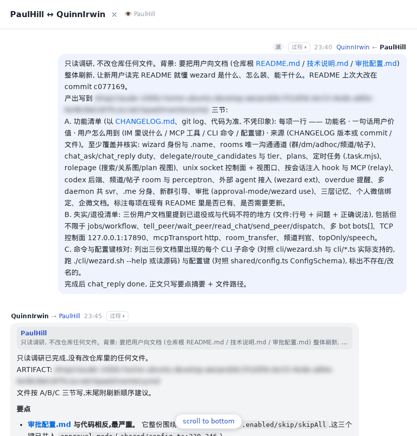
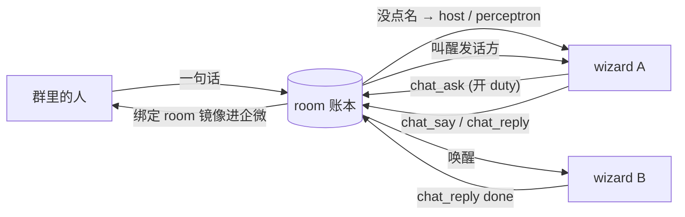
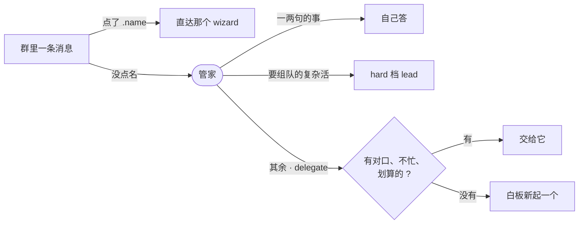
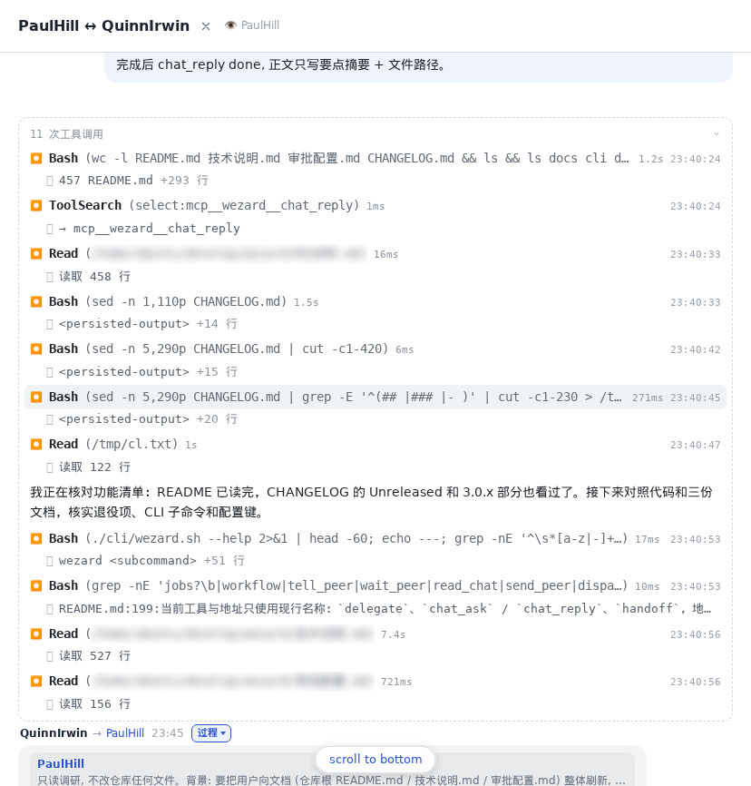
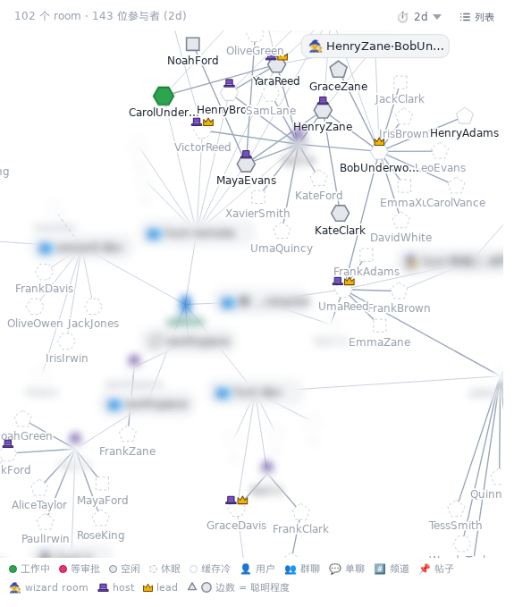
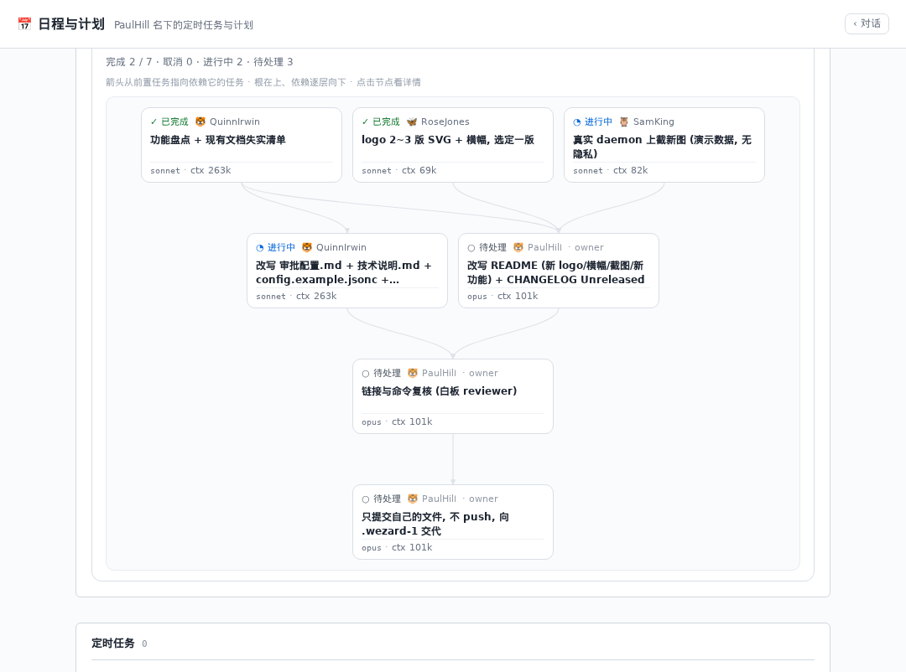
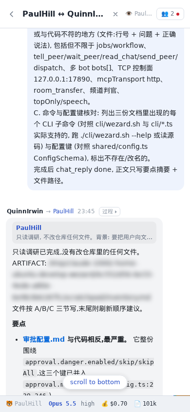

<div align="center">


<p>
  <a href="https://www.npmjs.com/package/wezard"></a>
  <a href="https://www.npmjs.com/package/wezard"></a>
  <a href="https://github.com/guxi11/wezard/stargazers"></a>
  <a href="LICENSE"></a>
  
  
</p>

</div>

**wezard 把你本机的 AI 编程 Agent（Claude Code / claude-internal / CodeBuddy / Codex）接进企业微信：地铁上发一句话，电脑上的 Agent 就开始干；它们不止一个，彼此看得见、叫得动，还能自己分工。**

- **遥控**：企微里说的话原样落进本机 CLI 的输入框，回到电脑前 `tmux attach` 接着干，对话一字不少。
- **把关**：危险操作（强推 / `DROP` / 数据卷删除 / 敏感路径）推一张审批卡等你点；想要每次调用都问，一个配置项切到 `all`。
- **协同**：一个群里住着多个有名字（`.name`）、有职责、有记忆的 **wizard**。没点名的话落到管家，由它派给对口的那个或新起一个；派出去的活不必守着等，对方干完自己会回来叫醒发话方。
- **看得清**：每个 wizard 都有自己的 **rolepage**——它视角下的 IM，每一轮的工具调用与思考过程、谁和谁说过话、计划进度一目了然。
- **不丢**：电脑重启、tmux 关了、daemon 崩了，下一条消息自动把会话拉起来，历史完整继承。



<details>
<summary><b>目录</b></summary>

- [快速开始](#快速开始)
- [核心概念：wizard · room · duty](#核心概念wizard--room--duty)
- [远程控制与双向镜像](#远程控制与双向镜像)
- [远程审批](#远程审批)
- [多 wizard 协同](#多-wizard-协同)
- [派完就放手](#派完就放手)
- [rolepage](#rolepage)
- [新群引导](#新群引导)
- [频道与帖子](#频道与帖子)
- [我的分身 .me](#我的分身-me)
- [定时任务与跨群通知](#定时任务与跨群通知)
- [说人话改配置](#说人话改配置)
- [图片与文件](#图片与文件)
- [企业微信文档](#企业微信文档)
- [绑定个人微信](#绑定个人微信默认关)
- [外部 agent 接入](#外部-agent-接入)
- [多 CLI 后端](#多-cli-后端)
- [运行与部署](#运行与部署)
- [命令速查](#命令速查)
- [常见问题](#常见问题)
- [深入了解](#深入了解)
- [参与贡献](#参与贡献)
- [License](#license)

</details>

---

## 快速开始

**前置**：macOS / Linux、Node ≥ 20、`tmux`、PATH 里能找到 `claude` / `claude-internal` / `codebuddy` / `codex` 之一（至少一个）、企业微信「智能机器人」的 `botId` + `secret`。

**1. 安装并初始化**

```bash
npm install -g wezard
wezard init
```

按提示填 `botId` / `secret`、选要用的 CLI（可多选，第一个决定新会话默认用谁）、选是否开启远程审批，其余自动完成：写配置、装常驻 daemon（macOS launchd / Linux `systemd --user`）、同步内置 skill。

**2. 绑定默认会话**

`init` 提示后，在企业微信里给机器人发：

```
将本对话设置为默认会话
```

口令 10 分钟内有效。全新安装时，直接单聊机器人发任意消息即可，无需口令。

**3. 开始使用**

1. **发首条消息**：在企微里随便说句话（比如 `hi`），一个 wizard 就位并回话。
2. **切到你的项目**：对 AI 说「切到 /path/to/proj」，它记下新目录并在该目录重开；`/pwd` 随时确认。
3. **审批**：缺省只有危险操作会弹卡（见[远程审批](#远程审批)）；想每次调用都点一下，对 AI 说「每次调用都要我确认」。点卡片里的链接看完整 input / result / git diff。
4. **查命令**：发 `/help` 拉出命令表——`/new` 开新会话、`/clear` 清上下文、`/sessions` 切换、`.name` 叫任意 wizard、`/usage` `/cost` 查额度。

升级用 `wezard update`（一条命令装新版本、重指 daemon、清理旧注册）。卸载见[常见问题](#常见问题)。

---

## 核心概念：wizard · room · duty

三个词就能读懂 wezard 的其余部分。

**wizard** —— 一个绑定了聊天的常驻 Agent 会话：有自己的终端、工作区、职责和长期记忆，有一个**全局唯一**的名字，写作 `.name`——不管它住在哪个群，在任何群里都叫得到。第一次叫出来时它拿到一份「宪章」（我是谁、还有谁、能用哪些工具、怎么在群里说话），换会话、清上下文后自动重发。

**room** —— wezard 里唯一的沟通通道，一份只追加的账本。企微的群、单聊、频道与帖子是**绑定了传输的 room**，说进去的话会真的发到企微；两个 wizard 之间的对话是不进企微的 **dm**；三个以上临时凑的是 **adhoc**。人和 wizard 说的每一句都按同一个口子写进账本，完成、出处、发言权都是行上的显式字段。**一轮的终句不会自己进群**——wizard 想让谁看见，就得用工具（`chat_say` / `chat_reply` / `notify`）说进某个 room。

**duty** —— 「这件事你得交代」。`chat_ask` 给某个 wizard 开一条 duty，对方只能用 `chat_reply` 交代：`done` / `passed` / `canceled` 才关账，`need`（反问）/ `progress`（中间进展）不关。人也能被开 duty——wizard 反问你之后，你的下一句话关账并叫醒它。完成只认这个 status，不靠猜。



---

## 远程控制与双向镜像

**你得到**：手机上说话，电脑上的 CLI 就是你坐在那儿敲出来的；坐回电脑前，一切都在原地。

```
企业微信                         daemon                           tmux 里的 Agent CLI
 你: 改成异步的  ──────────►  记进 room 账本  ──paste-buffer──►  输入框里出现这一句, 回车
                                                                  │ 干活: 读文件 / 改代码 / 跑命令
 群里出现 wizard 的话  ◄──────  room 工具写账本、镜像进群  ◄───────┤ 调 chat_reply / chat_say
 审批卡 / 提问卡        ◄──────  PreToolUse hook 长轮询  ◄─────────┘ 要跑 Bash / Edit 了
```

- **IM → CLI**：消息由守护进程 `tmux paste-buffer` 进 CLI 的输入框——这是唯一能让远程消息出现在你本机窗口里的通路。图片随消息一起贴进去；尾巴上那段 `<system-reminder>` 是守护进程顺手捎给 wizard 的群况（谁在、忙不忙），不占一轮对话。
- **CLI → IM**：wizard 在群里说话只通过 room 工具；你一发消息，群里先挂一个「处理中」气泡，第一条回复把它覆盖。每一轮的工具调用与思考过程记进 [rolepage](#rolepage)，不刷群。审批卡、投票卡和 `[mirror]` 通知由守护进程直接推。
- **随时接管**：`tmux attach -t wezard` 回到那个 pane 接着干。所有 wizard 住在同一个 tmux session 的不同窗口里。
- **重启即续**：电脑重启 / tmux 关了 / daemon 崩了都不掉档：下一条消息自动 `--resume` 把会话拉起来，欠着的话与交代按游标接着投。

---

## 远程审批

**你得到**：Agent 动手之前，危险的那几下先过你的眼。

每次工具调用经 PreToolUse hook 到 daemon，按判定链处理：先看规则（`denyRules` 拒、`allowRules` 放），再看 `approval.mode`：

| `approval.mode` | 谁会收到卡 |
| --- | --- |
| `danger`（**缺省**） | 只有命中危险名单（强推 / `DROP TABLE` / 数据卷删除 / 敏感路径等）或你写进 `askRules` 的调用；其余静默放行 |
| `all` | 每个命中 `matcher` 的调用，除非被 `allowRules` / ⏱窗口 / 会话缓存豁免 |
| `skip_all` | 没有人——一律放行（`denyRules`、提问卡、计划卡仍照常） |

- **卡上的按钮**：`✅` 放行一次、`⏱10h自动过` 一段时间内自动放行、`✅总是` 把这次调用记成 `allowRules`、`❌` 拒绝。危险名单命中的卡只有 `❌` / `✅ 确认执行`，每次单独确认，不吃窗口和缓存。
- **提问与计划**：Agent 提的选择题变成投票卡；做完计划推计划卡（`✅同意` / `✏️继续改`）。
- **特殊对待**：外部接待 wizard 的非 wezard 调用、Codex 的沙箱权限请求一律单次发卡，`skip_all` 也压不过；`.claude/**` 的改动会触发 CLI 自己的原生确认框（hook 管不到），wezard 会在放行后替你按掉，不让 pane 静默卡死。
- **随时切换**：IM 里 `/use cli` 把审批交还本地 CLI 弹框，`/use wecom` 交回；本机 `wezard use [cli|wecom]` 同效。对 AI 说「只审危险操作」「跳过所有审批」会改 `approval.mode`（放权项，需你点确认卡）。

完整判定链、规则语法、每个 `approval.*` 键见 [审批配置](审批配置.md)。

---

## 多 wizard 协同

**你得到**：不是一个 Agent 在排队，而是一群各管一摊、能互相叫的 Agent。

**创建与叫**

```
.docs /new        让一个叫 docs 的 wizard 在这个群里就位
.api 看下这个报错   开头写一个还不存在的 .api = 就地叫出一个新的 api，并把这句话发给它
/new              重开本聊天默认的那个 (不继承上下文)
.docs 帮我把 README 的目录补一下
帮我看下这个报错 .api
/pwd .docs        只看 docs 的工作区；/stop .api、/clear .docs 同理
```

消息里任意位置带一个已有的 `.name`，就发给那个 wizard；不带 `.name` 的消息发给本聊天默认的那个。在哪个群叫它，回复就回到哪个群。每条 wizard 的回复都带 `🧙 name：` 署名头，引用它的气泡就等于跟它说话。句中的 `a.ts`、`.gitignore` 这类不会被当成名字；名字支持中英文、数字、`_`、`-`，最长 32 个字符，大小写不敏感。

**管家与分派**

每个聊天的默认 wizard 是这个群的**管家**，档位由 `models.router` 指定（缺省 `standard`）。没点名的话落到它这儿：一两句能答完的（问进度、谁在干什么、闲聊）自己答；要读很多代码、改文件、跑很久的活，哪怕它做得了也**派出去**——它一忙，这个群里没点名的话就都排在它后面。

派活是一步 `delegate`（产出是一条 `chat_ask`）：守护进程先列候选——谁的职责、最近的话、读过的文件和这件活有交集，在不在同一个工作区，忙不忙，上下文多重、缓存冷没冷——再给一个默认决定：证据够强、不忙、接着用那段上下文划算的头一个候选就交给它，否则从白板新起一个，档位按活定。管家照办，或显式推翻（点名、硬要新的、换档）。



**手闸**：管家常常说着分派、实际埋头自己干。守护进程在审批链最前面拦它——改文件、开子代理一律拒；读、搜、跑命令每轮最多 4 次（`chatPolicy.<群>.stewardBudget`），超了就拒并叫它 `delegate`。放行窗口、`✅总是`、`skip_all` 都压不过这道闸。

**档位**：由轻到重 `mini` / `light` / `standard` / `hard` / `ultra`，在 `models.backends.<backend>.tiers` 配置（Claude 缺省 haiku·low / sonnet·medium / sonnet·medium / opus·high / opus·max）。范围清楚的编码默认 `light`；要判断的设计、排障、审查用 `hard`。也可以直接点模型与 effort。rolepage 里 wizard 节点的多边形边数就是它的档位。

**复杂的活交给 lead，用 plan 记账**：要拆成多阶段、需要 coder 与 reviewer 配合的任务，管家交给一个 lead。lead 用 `plan_create` / `plan_get` / `plan_list` / `plan_update` 维护自己的 plan——一份带依赖的任务 DAG，状态是 `pending` / `in_progress` / `completed` / `canceled`，只有 owner 能写（`revision` 做并发保护）。**daemon 只保存、校验和提醒，从不自动派活或验收**：并行节点怎么安排、验收后怎么推进，都是 owner 自己想。派活时给 `chat_ask` / `delegate` 带 `planId` 只做关联记录；owner 手上还有这个 plan 的未交代 duty 时不会被打扰，闲着而计划没动才被提醒一次。

**分身**：对 AI 说「分个身去把这三个目录都扫一遍」，分出三个**带着当前上下文**的分身并行干（`--fork-session`，原 wizard 不受影响，分身还能再分身）；也可以生一个白板子 wizard，顺便换工作区。创建的 wizard 始终归调用者管理；完成后默认保留，要结束只能本人或直属 parent，plan 没了结前不许退役。

**名字**

| wizard | 名字 |
| --- | --- |
| 新群的管家 | 新群引导落定（见[新群引导](#新群引导)），自动取一个中性英文名 |
| `.docs /new` 叫出来的 / 分身 | 你给的那个名字；省略则由守护进程分配（`Alice`、`Bob`…，用尽后 `AliceAdams`…） |
| 撞名 | 对方还在 → 拒绝并告诉你它忙不忙、静默了多久；对方已静默超过一天 → 新的直接接手这个名字 |

**直接对它说人话**

| 对它说 | 效果 |
| --- | --- |
| 你叫什么 / 你负责什么 | 报出自己的名字、职责和分身 |
| 以后你就叫 sanitizer | 改名，历史和上下文不受影响 |
| 记住：发版前必须更新 CHANGELOG | 写进它的长期记忆，`/clear` 之后仍在 |
| 记到这个群 / 这个仓库的记忆里 | 提交到群或工作区的共享记忆，之后来的 wizard 开局就知道 |
| 还有谁在跑 / 谁在弄那个项目 | 列出全部 wizard：名字、职责、忙闲、谁是谁的分身 |
| 让 .fix 看一眼这个报错 | 它给 `.fix` 开一条 duty 就放手去干别的，`.fix` 交代后会叫醒它，它再答你 |
| 还有哪些事没了结 | 管家用 `pending_items` 列出派出去仍未交代的 duty |
| 切到 /path/to/proj | 换工作区，重开会话 |

**三层记忆**：自己的、本群共享的、本工作区共享的。「这个群习惯先出方案再动手」「这个仓库 reload 要先 build」写一次，之后每个新 wizard 开局就知道（文件在 `~/.wezard/memory/`，你也可以直接改）。共享的两层是**提议**：守护进程每 30 分钟看一眼，有提议才起一个整理者去重、改写、合并（已经写在仓库 `CLAUDE.md` 里的不再收），所以不会被几十个 wizard 越写越长；合并后在场的 wizard 下一条消息会收到一行「记忆已更新」。

**上下文过了 200k 自己交接**：手上这摊告一段落，它就把工作压成一份简报、原地换一个全新会话接着干，名字和职责都不变。交接那几秒里进来的话都记在 room 账本里，新会话起来后按游标接着投，一句不丢。

---

## 派完就放手

**你得到**：派出去的活不用守着、不会悬着。

- **开 duty、走人**：wizard 之间用 `chat_ask` 开 duty、`chat_reply` 交代；对方交代会叫醒发话方，`need` 是反问（补信息或另开一条），`done` / `passed` / `canceled` 才算关了。`after` 可以让一条 duty 等前置的 duty 都 `done` 之后才叫醒对方。
- **对方正忙就等**：默认等它这一轮结束再投；急事 `interrupt` 先 Esc 打断（只有直属 parent、room 的 host 或人能用，且有回合预算）。投递靠游标记账：没投出去的话留在游标之后，重启 / 交接 / pane 重生之后接着投，不会丢。
- **一轮结束还欠着**：被唤醒的 wizard 结束时仍没交代，会在轮内被提醒一次（支持 Stop hook 的后端在它要收尾那刻拦住），再不交代守护进程给提问者写一条系统行；pane 真死了（两次扫描确认），它名下的 duty 由守护进程写 `canceled`。
- **久无动静有两级 overdue 提醒**：一条 duty 超过 60 分钟没有任何活动，daemon 唤醒处理人要它交代；120 分钟再往 room 记一行，room 没绑定企微时同步报到相关的群，让人看得见。它不会乱催：处理人**正忙**就这一轮跳过；一条 duty 派生出的子活还开着，催的是子活的处理人而不是你；每催一次只换回 `progress` 就按 60→120→240 分钟退避，连催两次仍只有 progress 就改记一行「球可能不在 .X 手里」，不再打扰。`rooms.overdue.*` 可调，设 0 关闭，从不自动 `canceled`。
- **群里只留结论**：wizard 之间派活、来回走 dm / 跟进 room，不刷群。想让过程别刷群，就让 wizard 开个跟进 room（或直接 `chat_ask` 一个非成员，自动落到两人的 dm / adhoc）；过程想看去 [rolepage](#rolepage)。

---

## rolepage

**你得到**：一个 wizard 视角下的 IM——它说了什么、怎么做的、和谁说过话、计划到哪一步。

点气泡头的 `.name`，打开那个 wizard 的 rolepage（页首那张截图就是私聊 room 的样子）。每条回复旁的「过程」可以展开成这一轮的完整记录：



- **两份数据，互不替代**：room 账本是「说了什么」（出处 / 完成 / 发言权写在行上），turn 记录是「怎么做的」（工具调用、CLI 原话、用量）。一轮的过程框挂在产出它的那条回复上；wizard 自己调的 `chat_*` 工具行也在其中。
- **侧栏与消息窗**：它参与的每个群聊、与人和与其他 wizard 的单聊；它发的靠右，收到的靠左；每一轮的工具调用收进可折叠的虚线框，进行中的一轮按秒走表；守护进程挂在消息尾巴上的 `<system-reminder>` 收成小标签，点开看原文。
- **`⌘K` 搜索**：按 role 名字、会话名、消息正文搜，回车跳到那个会话的那一句；空查询是最近会话的快速切换器。
- **关系图**：一棵树把家谱（谁是谁的分身）和对话（谁和谁说过话、几次）画在一起，人也是节点。多边形边数 = 档位，皇冠 = lead，紫色礼帽 = host，节点填白 = 缓存已冷。




- **计划视图**：在「计划 / 日程」入口只读查看 wizard 的 plans——状态、任务进度、依赖与暂停原因；暂停中的计划及其 owner 保持可见。修改计划由 owner 通过 plan 工具完成。


- **成员栏与群公告**：每成员一行（状态 · 名字 · 👁 视角 / ⭐ host / 👑 lead · 待交代数），顶部是群公告；成员进群 / 退出 / 被移除会显示成系统通知。
- **忙闲与用量**：空闲 / 执行中 / 等人点（停在审批卡或提问卡上，紫色）/ 已关闭；页脚用量条给出模型与档位、估算费用（按 LiteLLM 价格表逐轮计）、轮次、工具调用、上下文，以及 cache read / input / cache write / output 的分布。
- **未读**：已读全局只记一份，在任何一处读过，各处一起消掉。
- **名片**：名字、职责、工作区、模型与忙闲；点名字复制 `.name`；历史会话切换；日程列出它名下的定时任务。

窄屏（手机浏览器）下同一页面自动改成单栏，消息窗、成员栏与用量条照常可用：



页面链接里的 `?id=` 是一条不可猜的记录 id，它就是凭据：任一有效票据可以看全部 role。要给别人看又不暴露本机，把详情与 rolepage 推到独立的 [svr](#运行与部署) 上。

---

## 新群引导

**你得到**：把机器人拉进新群，一句话就绪。

bot 被拉进一个新群，会先由一个**引导会话**在群里问一件事：管家的工作区。给一个合法目录（以 `/` 或 `~` 开头）就完成绑定——daemon 在这个群里新建管家（目录上已有本 bot 的管家身份就直接绑它），自动取一个中性英文名，写入 `chatPolicy.<群>.steward`，引导会话当场收掉。你也可以一句话办完三件事：「给当前群聊命名为 demo，并绑定 workspace 为 ~/dev/myapp，然后给新的 host 命名 api」。引导会话没有工具面，只负责把 daemon 的指令说成人话；单聊不引导，默认接待者是全局管家。

wizard 的名字由它自己起（对它说「以后你就叫 sanitizer」）；改别人用 `wizard_identity({to})`，直属 lead 或管家可改。要换这个群的管家，对管家说「把这个群的管家换成 .xxx」，它会改 `chatPolicy.<群>.steward`（热生效）。`/name`、`/chats` 命令已下线，群只用 chat id 标识。

**群公告**：`/notice <文字>` 给本群立一条公告（≤500 字），群里所有 wizard 一直知道；`/notice` 看当前，`/notice clear` 清除。

---

## 频道与帖子

**你得到**：企微频道里 @ 机器人的帖子，也能让对口的 wizard 来答，并且评论回帖子下面。

频道和帖子是两种 room：频道 room 的账本一行是一个顶层帖子，帖子 room 是它的评论区；每个 room 有自己的 host 实例。出站看动作——频道里 `chat_say` 发新帖，`chat_reply` 回某条评论就评论回原帖；图片和内嵌文件也能收。一个信息源与 room 可以多对一绑定：频道里 @ 机器人的首触先落在频道 room、唤醒 host，由 host 判「并进已有 room（`room_bind`）还是另起帖子 room」，10 分钟没判就自动另起，话不丢。

**perceptron**：绑定 room 里没点名也没 @ 机器人的话，缺省落给 host，但有 wizard 成员的 room 会懒建一个只读的 **perceptron**（`wrc.channel.monitor`，缺省开，档位 `light`）：它**不能写任何消息**，只读账本和名册，给出一份「该回应的成员名单」，名单里的人名下各开一条 duty。被点中的 wizard 看到的只是人的原话。机制详见[技术说明](技术说明.md#perceptron谁该回应没点名的人话)。

---

## 我的分身 .me

**你得到**：一个只属于你的 wizard，替你协调、派活，不打扰任何群。

在任何聊天里以 `.me …` 开头说话，这段对话只进你和它的私有 room，不进本群记录（回复带「独立对话 · 不入本群记录」标注），回复发回你说话的地方。它不进已有的 room，但可以建 dm room、直接找别的 wizard 派活，审批卡发你私聊。

---

## 定时任务与跨群通知

**你得到**：到点自己干，没事不吵你。

到点把一句话说给 wizard 听，它就真的去干活，结果照常发回群里。任务常驻后台，CLI 重启、`/clear`、会话结束都不受影响。

| 对它说 | 效果 |
| --- | --- |
| 每个工作日晚上 9:30 跑一遍回归 | 排一个定时任务，到点新起一个 wizard 去干，干完收掉 |
| 每天早上 8 点在 .daily 里继续整理日报 | 到点把这句话发给已有的 `.daily`；它正忙就等这一轮结束再说（最多 30 分钟，仍忙才另起一个） |
| 每小时看一眼 CI，挂了再告诉我 | 「有事才说」：到点不预告、私下跑，没事只回一行 `QUIET`，群里什么也不出现 |
| 我设了什么定时 | 列出任务、时间和下次触发时刻 |
| 取消那个定时 | 删掉任务 |

认得的说法：`每天 8:00`、`每个工作日晚上9:30`、`每周三下午3点`、`每隔两小时`、`每 30 分钟`、`20 分钟后`、`明早 9 点`、`白天每小时`。每个 wizard 排的任务列在它 rolepage 的「日程」里。

**任务就是一个文件**：`~/.wezard/tasks/<id>.task.mjs`，导出 `when`（何时）/ `gate`（放枪前的检查，可以跑命令，返回 `false` 这一轮就不放，既不花一个 pane 也不出气泡）/ `prompt` / `target`、`fresh` / `quiet`。wizard 直接编辑它，存盘即生效；gate 在带超时的子进程里跑，卡死不会拖住别的日程。原理见[技术说明](技术说明.md#定时任务)。

**跨群通知**：让 wizard 把一段话贴进另一个群给人看，比如一个长活在 `build` 群跑完，把「🔴 回归挂了 3 例」送到 `ops` 群（`notify`）。

---

## 说人话改配置

**你得到**：不用打开 `config.jsonc`。

| 对它说 | 效果 |
| --- | --- |
| 现在模型档位是怎么配的 | 逐层列出这一节的每一项：类型、当前值、默认值、说明，标出哪些要人确认、哪些要 reload；`models` 下附各档本周 / 今日用量 |
| 把这个群的管家换成 .docs | 改 `chatPolicy.<群>.steward`，即时生效 |
| hard 档换成 opus·max | 先预演给你看改前改后的 diff，再落盘，注释原样保留 |
| 只审危险操作 | 改 `approval.mode`——这类**放权**改动由守护进程推一张确认卡，你点了才写 |

- 改动经 zod 整份校验才落盘；热生效的项写完即生效，其余提示 `wezard reload`。
- **放权项**（`approval.*`、`wrc.allowFrom`、CLI 后端与启动参数、监听地址、`weixin.enabled`、`external` 等）一律推卡确认，`skip_all` 也压不过；`bot.*` 与 secrets 里的字段读写都不行。
- 改动若影响到 wizard 的宪章（比如管家绑定、手闸次数），受影响的 wizard 会在下一条消息里收到「交接一下才按新规矩办」的提醒。

---

## 图片与文件

- **收**：在企业微信里发给机器人的图片随消息贴进 CLI 输入框；文件、视频解密后落进 `wrc.mirror.inboxDir`（默认 `~/.wezard/inbox`，超 7 天自动清理），以一行 `[文件: <路径> (<大小>)]` 交给 Agent；语音只有企业微信给的转写文字。企业微信只在**单聊**里推送图片 / 文件 / 视频 / 语音，群里 @ 机器人带图走图文混排。
- **发**：对 Agent 说「把截图发给我」，它调 `send_file({path, kind?, to?, caption?})`，默认发到本轮所在的聊天。企业微信侧上限：图片 png / jpg / gif ≤10MB、视频 mp4 ≤10MB、语音 amr ≤2MB、其余文件 ≤20MB；超限直接报错并给出改法。

---

## 企业微信文档

对 Agent 说「把周报整理成一篇企业微信文档」，它会新建在线文档、写入内容，把链接贴回会话；也能读文档链接、操作智能表格，文档归属到你本人。首次使用需在企业微信「工作台 - 智能机器人 - 可使用权限」里勾选「文档」「智能表格」。由官方 `wecom-unified` skill 提供，随包安装、按会话注入；`wezard skills list|install|remove|pin|unpin|update` 管它的落地状态。

---

## 绑定个人微信（默认关）

**你得到**：不在企业微信里，也能用微信遥控。

经腾讯的微信 ClawBot（iLink）把个人微信接进来：**每个扫码绑定的微信用户成为一个聊天**，与企业微信群同构——有自己的默认 wizard，`.name` 点名、叫出新 wizard 都照常。

1. 开启：`weixin.enabled` 是放权项，对 Agent 说「开微信通道」，点确认卡后 `wezard reload`。
2. 绑定：审批人在任意聊天发 `/wx bind [聊天名]`（或终端 `wezard wx bind`，会先推一张确认卡），二维码回到发起的聊天，用**要绑定的那个微信**扫码并确认；微信上显示配对码时发 `/wx code <码>`。
3. 绑定成功后先在微信里给「微信 ClawBot」说一句话——对方开口之前机器人不能发消息。

须知：

- 微信里只有纯文本：markdown 降成纯文本，审批 / 提问卡变成编号菜单（`【1】允许 【2】… · 短码 k7q`），回 `1` 或 `k7q 1` 作答。
- 送达受微信限制：人每说一句之后只能回有限几条（`weixin.sendCap`，默认 3），连发会合并、超出的压着，人再说话时补发；被频控会暂停出站；人说完话超过 `weixin.ctxTtlSec`（默认 120 秒）后，微信会静默丢弃主动推送，所以发往微信的**定时提醒做不到准点**。
- 图片 / 文件 / 视频双向可收发（单文件 ≤25MB）；不发语音条。
- `/wx` 看状态，`/wx unbind <序号|聊天名>` 解绑（聊天与记录保留）。一个微信号同时只能连一个 Claw，绑这里可能让别处（OpenClaw / WorkBuddy 等）的绑定失效。扫码提示「运行环境存在风险」多半是本机出网 IP 被风控，关掉 VPN / 全局代理再试。

---

## 外部 agent 接入

**你得到**：本机之外的 agent 也能向你的某个 wizard 提问、取回答案，但碰不到你的机器。

外部 agent 只用本机 CLI `wezard ext` 经 daemon 的 unix socket 说话：

```bash
wezard ext enroll --as foo --wait 60          # 首次: 向你私聊推一张登记卡, 点了才启用
wezard ext ask --wait 60 "帮我看下这个报错…"      # 发一条请求; --re <id> 续问
wezard ext wait <req> · inbox · ack <req…> · cancel <req>
wezard ext status · rotate <名字>              # 诊断 / 换口令 (需要 daemon 口令)
```

登记后 daemon 自建一个专属的**接待 wizard**（`ext-<名>`），外部请求只在它名下开 duty，再由它自己 `delegate`。接待 wizard 被收紧：除 wezard 自家工具外的每个调用都单次发审批卡；改配置、绑 room、排日程、停别的 wizard 等一律拒绝；交还给外部的答案会抹掉口令、密钥形态的字符串；每个调用方有每分钟 / 每天 / 同时未结的额度（缺省 10 / 50 / 5）。配置在 `external.*`（缺省开，名单为空时只有 `enroll` 可用）。设计与安全模型见[技术说明](技术说明.md#外部-agent-接入wezard-ext)。

---

## 多 CLI 后端

支持 `claude` / `claude-internal` / `codebuddy` / `codex`。daemon 可同时读取不同后端的现有会话；新 pane 的 CLI 统一由 `wrc.defaultCli` 决定（缺省 `claude`），`/new [model] [第一句]` 可选择模型并开始新会话。各后端读自己的 `models.backends.<backend>.tiers`；原生 clone 按父会话实际后端处理 fork。

**Codex**：安装 Codex CLI，先在终端完成 `codex login` 和工作目录信任确认，再设置 `~/.wezard/config.jsonc`：

```jsonc
{
  "wrc": {
    "defaultCli": "codex",
    "cliBackends": { "codex": { "disableSandbox": false } }
  }
}
```

执行 `wezard reload` 后，`/new` 起的就是 Codex。会话从 `~/.codex/sessions/YYYY/MM/DD/rollout-*.jsonl` 发现（支持 `CODEX_HOME`）；新会话由 Codex 自带的临时 `app-server` 创建 / 恢复 / 克隆，不发初始化消息、不产生模型请求，随后立即开 tmux pane 跑 `codex resume <id>`。镜像支持用户消息、助手回复、工具调用与结果、公开的思考摘要。wezard 启动的 Codex 会话自动带上 wezard MCP 与宪章（`developer_instructions`），不写全局 TOML；Codex 的缺省档位模型留空交给 CLI，effort 是 low / medium / medium / high / xhigh。

**Codex 审批**：`PreToolUse` 走 wezard 的审批策略，`PermissionRequest`（沙箱 / 网络权限请求）转成单独的确认卡，不沿用普通工具的窗口或跳过开关，`denyRules` 仍生效。daemon 断线或超时后，普通工具请求被拒绝，沙箱权限请求回到 Codex 自己的本地审批界面；Codex 的交互提问仍需在终端处理。

手工启动 Codex 时，在配置里加同步目标并执行 `wezard sync`：

```jsonc
"sync": { "targets": [ { "kind": "codex", "settingsPath": "~/.codex/hooks.json", "scope": "user" } ] }
```

（用 `CODEX_HOME` 时改成该目录的 `hooks.json`。）`sync` 只写 wezard 自己的那几条 hook 与 `config.toml` 里的精确信任哈希，保留第三方 hook；`wezard unsync` 移除。运行中的模型 / 推理强度切换请用 Codex 终端的 `/model`。CLI 参数参考 [OpenAI 官方文档](https://developers.openai.com/codex/cli/reference)，审批协议参考 [Codex hooks](https://learn.chatgpt.com/docs/hooks)。

---

## 运行与部署

- **三个进程**：常驻 **daemon**（唯一持有企微 WebSocket；macOS launchd / Linux `systemd --user`）、**hook**（`pre-tool-use.sh`，每次工具调用阻塞式长轮询）、每个 pane 一个小的 **MCP relay**（只用 node 内建模块，几 MB）。hook 与 MCP 都是**按会话注入**的，全机的 CLI settings 里不留 wezard 任何东西；`wezard sync` 只负责清理老版本写下的注册（codex 目标例外）。
- **控制面是 unix socket**（缺省 `<stateDir>/run/daemon.sock`，目录 0700、socket 0600）：别的用户连不上，daemon 重启的空隙里也没有可被抢占的端口。**浏览器视图口**（`daemon.host` / `daemon.port`，缺省 `127.0.0.1:17890`）只读、只挂 rolepage 与详情页；被占就从 `port` 起逐个 +1，实际端口写进 `<stateDir>/run/ports.json`，链接以它为准；`daemon.port: 0` 关掉视图口。详见[技术说明](技术说明.md#控制面unix-socket-与浏览器视图口)。
- **独立 svr（可选）**：`wezard svr` 起一个只读的详情 / rolepage 服务，部署在大家都够得着的机器上，daemon 用 `daemon.detailRemoteBase` 把记录推过去。同一台机器上的多个 daemon 可以共用一个 svr，票据只看自己那个 daemon 的记录。
- **小内存机的护栏**：空闲超过 `wrc.mirror.idleReapMin`（60 分钟）的 pane 自动收起（保留绑定，下一条消息 `--resume`）；活 pane 超过 `wrc.mirror.maxPanes`（20）从最久没动的收；Linux 上新建 wizard 前看一眼可用内存（`wrc.memoryGuard`），不够就明说，不把整机推进抖动。**备用池**（`wrc.sparePool`）提前冷启动好空白 CLI，新会话直接领用，省掉 2~3 秒的冷启动。
- **fd 与重启**：launchd plist 必须带 `SoftResourceLimits.NumberOfFiles`（模板已设 65536）；Linux 上 `loginctl enable-linger <用户>` 保证 ssh 断开后 daemon 不被停掉（`scripts/install.sh` 会检查）。

---

## 命令速查

**IM 里**（发 `/help` 拉完整表）：

```
/new · /clear · /stop · /n · /kill    会话控制（/kill 连 pane 一起收掉）
/sessions [emoji|id]                  列出 / 切换 live 会话
[.name] /new [model] [第一句]         重开 / 挑模型 / 叫出新 wizard
/model                                只读看当前模型 / effort（换模型让 wizard 用 set_model）
/reveal                               把终端的 tmux 窗口切到本会话
/peers · /wizards                     本聊天的 wizard：名字、职责、忙闲、家谱
/notice [文字|clear]                  本群公告（≤500 字，群里 wizard 都知道）
/wx · /wx bind|code|unbind            微信 ClawBot：状态 / 扫码绑定 / 解绑（审批人）
/id · /pwd · /usage · /cost           信息查询（免授权）
/audit [名字]                         本会话 token / 成本明细（含 subagent）
/cfgsync [apply]                      预演 / 执行跨 CLI 项目配置同步
/use [cli|wecom]                      审批交给本地 CLI 弹框 / 交回企微卡片（无参 = 看当前）
/help · /h                            全部命令
.me …                                 你的个人分身（只进你和它的私有对话）
```

**本机 shell**：

```bash
wezard init                # 交互式初始化
wezard status              # daemon + WS 健康、控制面 socket
wezard reconnect           # 重建企微连接，保留运行中的会话与审批
wezard logs -f             # 实时日志
wezard reload              # 重启 daemon（改了配置后用）；start / stop / restart 同理
wezard send <chat> <text>  # 主动推消息
wezard pending             # 未处理的审批
wezard use [cli|wecom]     # 审批交给本地 CLI / 交回企微（无参 = 看当前）
wezard wx [list|bind|unbind]   # 微信 ClawBot：终端扫码绑定 / 查看 / 解绑
wezard ext <enroll|ask|wait|inbox|ack|cancel|status|rotate>   # 外部 agent 接入
wezard skills [list|install|remove|pin|unpin|update]           # 内置 skill 的落地状态
wezard audit               # 当前会话 token / 成本明细（含 subagent）
wezard svr                 # 起独立的详情 / rolepage 服务
wezard config-path         # 当前使用的配置文件
wezard sync / unsync       # 清掉老版本写进全机的 hook / MCP / env（现在都按会话注入）；codex 目标会写 / 移除它的 hook
wezard update              # 升级：npm 装新版 + 重指 daemon + 清理旧注册
wezard uninstall [--purge] # 完整卸载（先于 npm uninstall）；--purge 连 ~/.wezard 一起删
wezard version
```

> ⬆️ **升级**：`wezard update`。升级前就在跑的会话要 respawn 才会带上按会话注入的 hook 与 MCP——空闲的会被 daemon 自动回收，下一句话 `--resume` 重起。
>
> ⚠️ **卸载顺序**：先 `wezard uninstall` 再 `npm uninstall -g wezard`。否则 launchd / systemd 会一直尝试拉起已删除的二进制。`~/.wezard/` 下的 config / secrets 默认不会被清，二次安装可无缝复用。

---

## 常见问题

**Q: hook 不触发？**
审批 hook 与 wezard MCP 都是按会话注入的：看那个 CLI 进程的启动行有没有 `--settings …/session-hooks.json` / `--mcp-config …/session-mcp-sock.json`（`ps -o command= -p <pid>`）。没有（或还是 `session-mcp.json` / `session-mcp-http.json`）就是升级前起的老 pane，空闲时 daemon 会自动回收、下一句话 `--resume` 重起；全机 settings 里本来就不该有 wezard。

**Q: 卡片点了没反应？**
企业微信卡片就地刷新只有 5 秒窗口，超时不刷新是正常的，决策本身仍然生效。

**Q: 明明开了审批，为什么很少收到卡？**
缺省 `approval.mode` 是 `danger`，只有危险操作才发卡。要每次都问：对 AI 说「每次调用都要我确认」，或把 `approval.mode` 设为 `all`。

**Q: daemon 起不来 / 连不上？**
`wezard logs -f` 看；常见是 `botId` / `secret` 写错卡在 WebSocket 鉴权。`wezard status` 显示 `down` 但进程还在，多半是控制面 socket 没起来，同样看日志。

**Q: daemon 反复崩溃重启？**
`~/.wezard/daemon.stderr.log` 里出现 `spawn EBADF` 就是 fd 软上限被几百个会话吃光了。别去改 `~/Library/LaunchAgents` 下那份 plist——`install.sh` 会从模板重新生成它，改 `launchd/com.wezard.daemon.plist.template`。

**Q: Linux 上 ssh 一断 daemon 就停了？**
没开 linger：`loginctl enable-linger <用户>`。

**Q: rolepage 链接打不开 / 端口不对？**
视图口被占会自动换端口，实际端口在 `<stateDir>/run/ports.json`，卡片里的链接已经跟着换；手动拼 URL 时以它为准。

**Q: 审批日志出现 `93006 invalid chatid`？**
连接认证成功不代表收件人有效。检查 `defaultChat` 或本轮镜像频道的用户 / 群 ID，并在对应机器人会话里发条消息确认可用；不要用放行配置绕过发送失败。

**Q: 多机部署？**
`config.jsonc` 可以纳入 dotfiles；`secrets.json` 每台机器独立填。第二台机器跑 `wezard init` 会跳过覆盖提示，但仍要重新走 claim 步骤拿本机 IM principal。

---

## 深入了解

- [技术说明](技术说明.md) — 架构与控制面、消息双向同步、`.name` 路由、wizard 网络（身份 / 记忆 / 分身 / 感知 / 分派 / 编排 / room 账本 / perceptron / overdue / 交接）、定时任务、外部 agent 接入、多 daemon 共 svr、rolepage、缓存冷热判定
- [审批配置](审批配置.md) — 审批粒度、危险名单、完整判定链、特殊调用、`approval.*` 速查
- [config.example.jsonc](config.example.jsonc) — 带注释的配置样例
- [docs/room/contract.md](docs/room/contract.md) — room 账本契约；[docs/dev-guide.md](docs/dev-guide.md) — 开发者改动清单
- [CLAUDE.md](CLAUDE.md) — 模块级职责与代码约定
- [CHANGELOG.md](CHANGELOG.md) — 各版本变更

---

## 参与贡献

欢迎 issue / PR。本地开发：

```bash
git clone https://github.com/guxi11/wezard.git
cd wezard && npm install
npm run build          # tsc → dist/
npm run typecheck      # tsc --noEmit
npm run dev:daemon     # tsx 直跑 daemon，热迭代不用装
./cli/wezard.sh reload # 重编译并重启常驻 daemon
./cli/wezard.sh logs -f
```

架构与模块职责见 [CLAUDE.md](CLAUDE.md)。运行时改动需跑 `npm run typecheck` 与适用的 `tests/*.test.ts`；测试脚本逐个用 `npx tsx` 执行，没有 `npm test` 入口。

## License

[MIT](LICENSE) © [guxi11](https://github.com/guxi11)
