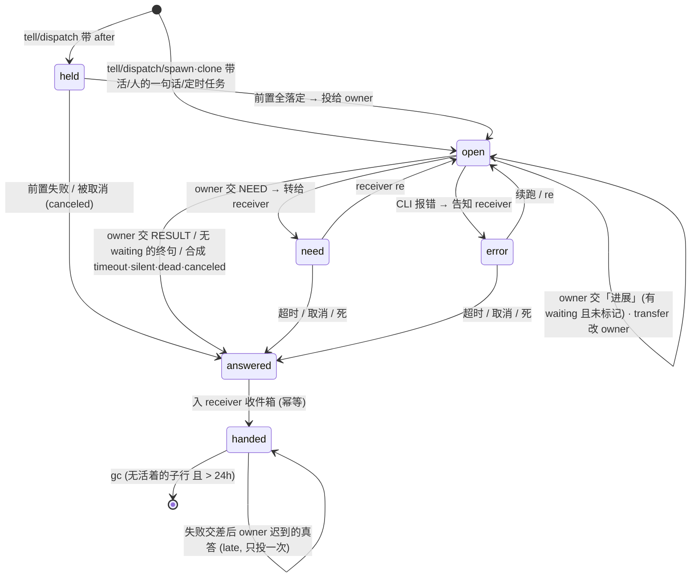

# 回执路由表: 显式 `<event, receiver>` router (方案)

> `.rcptroute` · 2026-10-14 · 只出方案, 未改代码
> 人的要求: 用显式路由表替代 chained reply-to —— 每个 wizard 绑一个 `<eventid, receiver>` 数组; 来源 (人 / wizard) 的 eventid 沿 dispatch / tell 链传下去; wizard 拿到这个 id 的定论后把结果交给 receiver, 并删掉这条记录。并行多笔、回执不丢、daemon 定路由 / LLM 定 NEED·RESULT、落盘、不兼容旧版。
> 取代: `receipts.ts` 的父 k / deferred / relay / reply-to, `receiver-stack.md` 的冻结栈 + delegate, `answer-transfer.ts`, `message-events.ts` 的 continuation 代数。

## 0. 一句话

**一件活 = 一行路由**: `event` (这笔欠账的 id) · `owner` (谁欠) · `receiver` (欠谁)。派活就是插一行, 交差就是把定论按 `receiver` 投出去再删行, 转手 (transfer) 就是改 `owner`。「谁在等谁」不再从信封和回执槽里推断, 而是表里一条条看得见的边; 所有旧的续回 / 挂起 / 链头逻辑都退化成对这张表的查询。

---

## 1. 参照的开源实践

| 实践 | 要点 | 本方案取用 |
|---|---|---|
| EIP **Correlation Identifier** + **Return Address** (Hohpe & Woolf) | 请求里显式带「回给谁」和「对应哪一问」, 应答方不靠推断 | 每行显式存 `receiver`; 回执信封带 `event` (对应哪一笔) |
| AMQP RPC (`reply_to` + `correlation_id`) | 二者组成的二元组就是一张最小路由记录 | 行 = `(event, receiver)`, 正是人的设想 |
| EIP **Process Manager** vs **Routing Slip** | 路由状态放中心 (可校验、可恢复) vs 随消息携带行程单 (可被篡改、复制多份) | 选中心表 —— LLM 不碰路由; `receiver-stack` 的「冻结栈」本质是 routing slip, 每行复制整条祖先, 这里改成每条边只存一次 (规范化) |
| EIP **Aggregator** / Scatter-Gather | 扇出后要有「完成条件」: 全到 / 超时 | `waiting(e)` = receiver 指向 e 的未落定行, 由表派生, 不另存计数; 同一 e 排队中的多份回执合并一次投递 |
| **Saga** / 编排式 | 长事务每步可失败, 失败要有确定的去向 (补偿) | 失败也是定论: timeout / silent / dead / canceled 照常沿 receiver 投递; 不做补偿, 只做级联取消 |
| **Temporal** child workflow · Parent Close Policy (TERMINATE / REQUEST_CANCEL / ABANDON) | 父结束时子怎么办必须是声明的策略; 事件历史持久化, 重放恢复 | 父行提前收口 → 子行 ABANDON (结果仍回 owner, 标 `late`); `stop_wizard` → 子树 TERMINATE (级联 canceled); journal 重放恢复 |
| **Erlang/OTP** `call` (make_ref + monitor + timeout) · supervisor 升级 | 每次调用一个唯一 ref; 被调方死了收到 `DOWN`; 处理不了就交上级 | event id = ref; pane 死 = `dead` 回执; receiver 本身不在了 → 沿它自己的 receiver 往上升级 |
| Akka **ask** pattern | 临时 reply 地址 + 超时, 超时即合成失败应答 | 行带绝对 `deadlineAt`, 到点合成 `timeout` 投递 |
| **Transactional Outbox** + **Idempotent Receiver** | 「记下要发」与「真的发出」分两步, 发送端可重放, 接收端按 id 去重 | 行先落 `answered{outcome}` 再入收件箱; 入箱按 `rcpt:<event>` 幂等, reload 重放不重投 |
| **Event Sourcing** (append-only journal) | 状态 = 对操作日志的 fold; 撕裂的尾行可丢, 不至整表作废 | `routes.jsonl` + 纯函数 `step(table, op)` |
| **W3C traceparent** (trace-id + parent span-id) | 一个 id 同时给出根和父 | event id 用层级串 `e3f9a1.2.1`: 第一段 = 来源 (根), 前缀 = 派它的那一笔 |
| gRPC **deadline propagation** | 子调用的期限不超过父的剩余期限 | 子行 `deadlineAt = min(自带, 父行 deadlineAt)` |
| **Dead Letter Channel** | 投不出去的消息进专门的通道而不是丢弃 | 无处可投 → 根所在群的 rolepage + 顶层 wizard 的待办 |

---

## 2. 数据结构

### 2.1 行

```ts
/** 层级 id: `<root>.<n>.<n>…`。root = 来源 (人的一句话 / 定时任务 / 无上游的 wizard 派活) 时新领的 `e` + 6 hex;
 *  子行 = 父行 id + "." + 父行自增序号。只用于追踪与展示 —— 语义一律走 receiver 边, 不解析前缀 (transfer 后两者不一致)。 */
type EventId = string;

type Receiver =
  | { kind: "chat"; channel: string; message: string }   // 定论 = 群里那句人话 (message-event id) 的答复气泡
  | { kind: "wizard"; owner: Key; event?: EventId };      // 定论作为回执进 owner 的收件箱; event 缺省 = detach (不挂在它任何一笔欠账上)

type Status =
  | "held"      // after 前置未落定, 尚未投给 owner
  | "open"      // 已投给 owner, 在干 (含挂着子行)
  | "need"      // owner 交了 NEED, 已转给 receiver, 等对方 re
  | "error"     // owner 的 CLI 报错停了, 已告知 receiver, 等续跑 / re
  | "answered"  // 定论已定 (outbox 已落盘), 还没进 receiver 的收件箱
  | "handed";   // 已入 receiver 收件箱 / 已排进群的答复 = 墓碑

interface Route {
  event: EventId;
  owner: Key;               // target key, 不是名字: 改名 / handoff 都不动它
  receiver: Receiver;
  status: Status;
  at: number;               // 插入时刻
  deadlineAt: number;       // 绝对时刻, reload 后照算
  seq: number;              // 给子行编号
  job?: string;
  after?: EventId[];        // 仅 held
  outcome?: { status: "done" | "timeout" | "silent" | "dead" | "canceled"; body: string; rev: string };
  late?: true;              // 先以失败交差, owner 之后又真答了 —— 迟到的那份再投一次即删
}
```

**逻辑上每个 wizard 一个数组** (`routesOf(owner)` = owner 是它的行), **物理上一张表**: transfer 要把一行从 W 的数组挪到 B 的数组, 分两个文件就没有原子性。

### 2.2 派生查询 (纯函数, 不另存)

| 查询 | 定义 | 取代 |
|---|---|---|
| `waiting(e)` | `receiver.event === e` 且 status ∈ {held, open, need, error, answered} 的行 | `children` / `siblings` / `deferred` / `awaitingContinuation` |
| `chain(e)` | 沿 `receiver` 往上走到 chat 或 detach | `ancestorsOf` / 冻结的 `stack` / 方向闸的链 |
| `owedBy(W)` | owner = W 且未 handed | `owed` / `carryRest` 的欠账列表 |
| `awaitedBy(W)` | `receiver.owner === W` 且未 handed | `pending_items` 的「我派出去还没了结的」, `outstanding` |
| `subtree(e)` | receiver 边的传递闭包 | 级联取消 |
| `speaksToHuman(e)` | `row(e).receiver.kind === "chat"` | `topOnlyMuted` / `eventFinalGate` / `hasAnswerChildren` 的三套推断 |

### 2.3 落盘: `~/.wezard/routes.jsonl`

append-only, 一行一个操作, 状态 = `ops.reduce(step, empty)`:

```jsonc
{"op":"open","at":…,"event":"e3f9a1.2","owner":"chat:wr…#fix","receiver":{"kind":"wizard","owner":"chat:wr…","event":"e3f9a1"},"deadlineAt":…,"job":"j12"}
{"op":"hold","at":…,"event":"e3f9a1.3","owner":…,"receiver":…,"after":["e3f9a1.2"],"deadlineAt":…}
{"op":"release","at":…,"event":"e3f9a1.3"}
{"op":"mark","at":…,"event":"e3f9a1.2","status":"need"}          // need / error / open
{"op":"move","at":…,"event":"e3f9a1","owner":"chat:wr…#impl"}     // transfer
{"op":"answer","at":…,"event":"e3f9a1.2","outcome":{…}}           // outbox 提交点
{"op":"hand","at":…,"event":"e3f9a1.2","inbox":"rcpt:e3f9a1.2:r1"}// 已入 receiver 收件箱
{"op":"gc","at":…,"event":"e3f9a1.2"}
```

- **先写日志后改内存** (`appendFileSync`): 内存里有的, 盘上一定有。daemon 单进程、事件循环串行, 无锁。
- 读: 逐行 parse; **只有最后一行**允许是撕裂的 (崩溃中途写), 丢掉它; 中间行坏 = 报错拒绝启动 (不能像 `json-map-store` 那样「坏了当空表」—— 这里丢表 = 丢回执)。
- 压实: boot 时与日志超过 N 行时, 把 fold 结果重写成一组 `open`/`mark`/… 行, tmp + rename 原子替换。
- 诊断: `GET /routes?owner=` 按 wizard 渲染它的数组; rolepage 的工单页 / 名册读同一份。

---

## 3. 生命周期 (状态机)



### 3.1 插入 (谁、何时)

所有入口收成一个 `router.open(...)`, 写入点只有这些:

| 入口 | owner | receiver | event |
|---|---|---|---|
| 人在群里对 wizard 说一句 | 被点名 / 默认的 wizard | `{chat, channel, message}` | 新根 `e…` |
| 定时任务开一轮 | target | 任务配置的群 → `chat`; 否则无行 | 新根 |
| `tell_peer` / `dispatch` / `spawn_wizard`·`clone_wizard` 带 task, `return:"self"` (默认) | 目标 B | `{wizard, W, event: f}` | `f.<seq>` |
| 同上, `return:"detach"` | B | `{wizard, W}` (无 event) | 新根 |
| 同上, `return:"transfer"` | **不插行**: 把 f 那一行 `move` 给 B | (不变) | f (沿用) |
| `return:"none"` / `kind:"fyi"` | **不插行** | — | — |
| 带 `after` | B, status `held` | 同 self/detach | 同 self/detach |
| workflow plan 的节点 | 节点 wizard | plan 发起者那一笔 | 同 self |

`f` = 这件子活是为 W 欠着的哪一笔派的: 显式 `for: <event>` (必须 ∈ `owedBy(W)` 且未 answered, 否则 400 并列出 W 欠着的几笔), 缺省 = **W 这一轮所服务的那一笔** (见 3.3)。这一轮不服务任何一笔 (人在 CLI 里直接敲的、detach 回执轮) → 等同 detach。

### 3.2 删除 / 移交 (定论怎么产生、怎么走)

owner 一轮结束时, daemon 拿到 `(owner, servedEvent, closingText)` (来自 message-events 的 turn final, 不再去 transcript 里按信封搜答句), 交给纯函数 `onFinal(table, …) → Op[]`:

| owner 的终句 | `waiting(e)` | 结果 |
|---|---|---|
| `NEED: …` | 任意 | `mark need` + 把这段作为 `need` 投给 receiver; 行留着 |
| `RESULT: …` | 任意 | `answer done`。有 waiting = LLM 决定提前收口, 子行变孤儿 (见 4.3) |
| 未标记 | 空 | `answer done` |
| 未标记 | 非空 | **进展**: 只进 rolepage, 行不动 (= 旧 deferred, 但条件是表里看得见的 `waiting`) |
| (空 / 连续 N 次停下没答) | — | `answer silent` |

`answer` 之后立刻走 outbox 两步: ① 按 receiver 投递 —— `chat` → 排进那句人话的答复 (message-events 的 final 通道); `wizard` → 往 receiver 的收件箱 enqueue 一份回执, id = `rcpt:<event>:<rev>` (幂等); ② 入箱成功落 `hand`。「从数组中删掉」= `hand` 之后这一行不再出现在 `owedBy` / `waiting` 里; 墓碑留着只为两件事: 子行还要沿它往上走 `chain`, 以及失败交差后的 `late`。

回执进 receiver 那一轮, **所服务的那一笔 = `receiver.event`** —— 于是 W 在这一轮的终句又落到 W 自己那一行上, 按上表再走一遍。递归在这里闭合: 叶子交差 → 回执轮 → 父交差 → … → 根交进群。

### 3.3 一轮 ↔ 一笔 (路由的唯一前提)

daemon 投进 pane 的每条消息都带 `event` (人话、派活、回执、续问、nudge), 并在投递那一刻把「这一轮服务哪一笔」记进 turn store。保证不串的两条规则:

1. **不同笔不并入同一轮**: 目标忙时, 另一笔的消息排队到它闲下来 (`priority:"normal"`); `now` 只允许同一笔内 (`re` 答 NEED、补充) 或不建行的 `fyi`; `urgent` = 先 Esc 打断当前轮, 被打断那一笔留 `open`, 新一笔那一轮结束后 daemon 自动补一句「继续 <event>」。
2. **同一笔的多份回执可以合并**: receiver 收件箱里排着几份 `receiver.event` 相同的回执 (扇出的兄弟陆续回来) → 一次投递拼在一起, 一轮处理 (Aggregator)。

### 3.4 transfer (尾调用) = 改 owner

W 在服务 f (receiver = X) 时 `tell_peer({to: B, return: "transfer"})`:
- 前置: `waiting(f)` 为空 (否则谁来交代有歧义 → 409)。
- `move f → B`, 活以 `event = f` 投给 B。W 这一轮及之后对 f 的产出不再算数 (f 已不在 `owedBy(W)`); W 再对 f 派活 → 400。
- B 的 NEED / 失败 / 定论都直接按 f 的 receiver 走到 X。X 用 `re: f` 续问, 找到的就是此刻的 owner B。
- 连续 transfer = 连续改 owner, 一跳直达, 不增深。

### 3.5 held 行的注入载荷 (放行后谁把活投出去)

带 `after` 的派活在前置没落定前**不进注入队列**, 只在行上冻一份注入载荷; 前置全落定, daemon 按载荷走一次正常 open 流程。

**行上增一个字段** (§9.1 增补):

```ts
/** 仅 held: 放行那一刻要注入的那份活, 开行时整份冻结。放行的注入 = 把这份快照原样交给
 *  message-events —— 行自己就是全部依据, 不依赖别的存储 (收件箱是宽松存储, 丢了不丢活)。 */
interface HeldInjection {
  id: string;            // `route:<event>` —— 注入事件的幂等 id, 与行 event 绑定
  channel: string;
  priority: "normal" | "now" | "urgent";
  payload: {
    text: string;
    peer: {
      from: TurnFrom;
      /** 开行时渲染好的信封 —— 不含前置结论: afterNote 由 inject 适配层在注入时现拼
       *  (那时前置才有 outcome), 与直接派活同一段代码。 */
      envelope: string;
      tell?: Tell;         // dispatchKey 已冻定 (workflow 节点 = leg.key)
      attemptId?: string;
      job: string; kind: "task" | "ask" | "fyi";
      role?: "exec" | "reviewer" | "expert"; free?: boolean; spawned?: boolean;
      /** 给 jobs.account 的「这件曾停放」记号 (旧 `!p.held` 分支语义不变)。 */
      held: true;
    };
  };
}
Route.injection?: HeldInjection   // release 后留在墓碑里供审计, gc 随行走
```

target / speaker / serves / asker / deadline **不重复存** —— 从行推导 (`owner` / `receiver.to` / `event` / `asker` / `deadlineAt`; held ⇒ receiver 必为 wizard, 入口已保证)。`open` op 增可选 `injection`, `parseOp` 核形状 (`id` 带 `route:` 前缀、`payload.text`/`peer.envelope` 非空、priority 三词之一); `row` 快照行自动携带。

**谁写入**: 唯一的 `after` 入口 (`tell_peer` → `tellPeerAsInner`; 计划节点共用): 前置有 pending → 预览 event id (子行 = `${f}.${seq+1}`, 新根先领号) → 照直接派活构建整份 accept 入参 (workflow 的 beginNode / recordLeg 时机不动) → `open` op 携带 `injection` 一次落盘 (行与载荷同一条 op, 无撕裂窗) → **不调 `events.accept`**, 合成返回 `{queued:true, parked:true, after, event, …}` (形状照旧, MCP 无感)。前置已全 done → 照旧直接 accept, 行不带 injection。

**谁读出**: `releaseHeld(row)` = 一句 `events.accept(从行重建的入参)` —— accept 幂等 (同 id 同指纹返回已有), 不需要预检。顺序 **accept 先、`release` op 后**, 同一同步块: crash 在两者之间 → boot 重放时 accept 幂等 + 补落 release, 不丢; 反序则留「行 open 而无事件」的洞。触发器两处: boot 的 `settleHeld()` (现状), 与 **`commitRoute` 每落一条 `answer` 之后** (前置落定同一 tick 放行, 不等 sweeper); settleHeld 内循环到不再出新 op (held 的 canceled 也是 answer, 可能连锁放行)。`release` 的唯一写入点 = settleHeld —— `committed` 钩子里的 release (旧 T3 接线) 删除。

**为什么不停在注入队列里** (旧实现: dispatch 即 accept + ready 闸, 随 receipts 退役后无人注入只是表面): ① **队头阻塞** —— message-events 的 `injectable()` 让同 pane 后来的 normal 消息排在停放事件后面, 停多久堵多久; ② **期限洞** —— 队列事件的 deadline 一到被按 "deadline expired before submission" 收掉, 而 sweeper 不扫 held 行的期限, 行永远挂着。载荷上行架后两条都消失。

**边界**:
- **目标已死**: 放行即正常派活 —— 死 pane / 重试 / timeout 全走 message-events 与 sweeper 的现成路, 无特例。
- **前置失败**: sweepOps 与 settleHeld 两处 `answer canceled` (带前置快照) 幂等共存 (定论写一次); 不注入, injection 留墓碑。
- **停放期 reload**: 载荷在 routes.jsonl (严格读盘, 坏行拒启动), 与收件箱 (宽松存储, 坏了当空) 解耦 —— 收件箱丢了, 停放的活照样放得出去。boot: settleHeld 重查前置, 全 done 就地放行, pending 继续停。
- **held 超期** (前置一直没落定, `deadlineAt` 先到): sweepOps 的 held 分支补 `deadlineAt <= now` → `answer timeout` (理由「等前置等过头」) —— 现状 held 永不超时是个洞。
- **取消**: `cancelOps` 不区分状态, held 行直接 canceled; 没有队列事件要撤 (比旧实现少一步 `events.cancel`)。

---

## 4. 并行与失败

### 4.1 并行多笔

- **一个 wizard 同时欠多笔**: `owedBy(W)` 里多行, 各自有 waiting、期限、状态; 互不干扰。轮次在 pane 上串行 (3.3), 但每一轮都明确属于其中一行。
- **同一对之间并发多件**: 主键是 event 不是 `from→to`, 第二件不会顶掉第一件 —— 旧的 `parked`、「顶掉的那份继承工单」整套逻辑消失。
- **多份回执并发回来**: 都进 receiver 的持久化收件箱 (message-events), 闲时一份 (或同笔合并的一批) 一轮, 每份带自己的 `event`, 各落各的行。
- **同一 wizard 在一条链上出现两次** (W→B→W): 第二次是新 id `….1.1`, 与 W 原本那行不冲突; 方向闸用 `chain(e)` 判环 / 判深。

### 4.2 失败 (daemon 合成定论, 和 done 走同一条 outbox)

| 情形 | 判定 | 本行 | 子树 |
|---|---|---|---|
| `timeout` | 单个 sweeper 扫 `deadlineAt` (绝对时刻, reload 后照扫) | `answer timeout` (正文附 owner 最后一句) → 投递 | 不动 (ABANDON): owner 之后的真答以 `late` 再投一次 |
| `silent` | owner 停下 N 次没交终句 | `answer silent` | 同上 |
| `dead` | owner pane 没了且不在交接, 宽限 5s | `answer dead` | 子行照常干, 回执会投给已死的 owner → 走 4.4 升级 |
| `canceled` | `stop_wizard(B)` / `close_job` / interrupt | `answer canceled` (发起取消者若就是 receiver 则不投, 它自己知道) | **TERMINATE**: `subtree(e)` 全部 canceled, 叶子先落 |
| `held` 前置失败 | 前置行 outcome ≠ done | `answer canceled` (带前置结论快照) | — |

子行期限: `deadlineAt = min(自带 deadline, 父行 deadlineAt)` —— 父已经超时的活, 子再干也没人等。

### 4.3 孤儿 (父行先收口)

父行 f 已 `handed` (LLM 提前 RESULT, 或 f 超时), 子行 c 之后才交差: c 照常投给 receiver `{W, f}`, 信封标 `late` / `detached`; 那一轮服务的 f 已关 → 终句只进 rolepage。**结果不丢, 只是不再往上冒** —— 要不要追加交代, W (LLM) 自己决定 (比如 notify 或对 X 新开一件)。

### 4.4 receiver 不在了 (升级)

投递前看 receiver:
- wizard 还在注册表、只是 pane 离线 → 留在它的持久化收件箱, 回来再投 (现状: 不为送回执重开会话)。
- wizard 已被 stop / 注销 → 沿 `chain` 往上找第一个还活着的 receiver, 以 `via .W (已不在)` 投给它; 一直到 chat 根 → 进根所在群, 由顶层 wizard 收 (Dead Letter → 上级)。

### 4.5 reload / 交接恢复

boot: fold `routes.jsonl` →
- `answered` 未 `hand` → 重新 enqueue (幂等 id, 收件箱去重) → `hand`;
- `open` / `need` / `error` → 什么都不用重建: 定论由 message-events 的 turn final 回调送来 (它自己会恢复在途轮), 期限由 sweeper 接着扫;
- `held` → 重新检查前置。

handoff: owner 是 target key, 换 sid 不换 key → 表不动。新会话贴回简报后, daemon 对 `owedBy(W)` 里还 `open` 的每一笔各补一句「继续 <event>」(一轮一笔), 不再有「在旧 transcript 里把答案钉住」的 transfer 逻辑 —— 旧会话里已经出的终句早已经由 onFinal 落了表。

---

## 5. 分工边界: daemon 定路由, LLM 定语义

| daemon (确定性, 不可被模型绕开) | LLM (wizard 自己判断) |
|---|---|
| 每条消息带哪个 event、一轮服务哪一笔 | 这一轮交 `RESULT:` / `NEED:` / 只写进展 |
| 子行挂在哪一笔下 (校验 `for`) | 子活为哪一笔派 (`for`), `return` 选 self / transfer / detach / none |
| 定论投给谁 (`receiver`)、何时删行 | 收到子的 NEED: 自己答 (`re`) 还是往上冒 (自己交 NEED) |
| timeout / silent / dead / canceled 的合成与投递 | 收到失败回执: 换人、`re` 追问, 还是如实交差 |
| 孤儿 / 升级 / 合并投递 | 孤儿结果要不要追加交代 |
| 能不能对人说话 (`speaksToHuman`) | 话怎么说 |

**daemon 从不解释正文, 只认标记**: `NEED:` / `RESULT:` 是 LLM 写给 daemon 的两个指令; 未标记时只有一条兜底 (有 waiting = 进展, 没有 = 定论), 显式标记永远优先。daemon 也从不替 LLM 把 NEED 往上转 —— NEED 自动直达上游只发生在 transfer 之后, 那是 LLM 自己选的放弃中转。

---

## 6. 与现有概念的对应

| 现在 | 路由表里 |
|---|---|
| 件号 `t…` (turn) | event id (层级) |
| 回执槽 `Slot` (主键 `from\0to`) | 行 (主键 event) |
| 父 k (`ParentK`) / 冻结栈 `stack` | `receiver` (一条边) / `chain(e)` |
| `deferred` + `relay` + reply-to 续回 | `waiting(e)` 非空时的「进展」; 回执轮服务 `receiver.event` |
| chat 侧 `awaitingContinuation` / continuation 代数 | 同上 (chat receiver 只是 receiver 的一种) |
| `answer:"transfer"` / `Slot.delegate` / `leafOf` | `move` 改 owner |
| `chain:false` / `receipt:false` / `kind:fyi` | `return: detach / none` (fyi 隐含 none) |
| `Hold` 停放件 | `held` 状态的行 |
| `pending_items` | `awaitedBy(W)` 视图 (`drop` = 把那几行 detach) |
| `turn-state` 词表 (在等 / 欠着) | 由行状态 + 一次 pane 探测算出, 词表不变 |
| 工单 `jobs.ts` | 不变: 成员 / spawnedFor / 预算 / 验收 / plan; 行带 `job`, 行 `answer` 时 `settleJob` 一次, done/total 照旧从账本读 |
| `tell_peer.re` | `re: <event>` = 答 / 续问 `awaitedBy(我)` 里那一行的 owner (transfer 过就是新 owner) |
| `wait_peer` | 同步取走 `awaitedBy(我)` 里某行的 outcome: 取走即 `hand` (收件箱那份撤掉) |
| 方向闸 / 链深 | `chain(e)` 长度与成员 |
| topOnly 收口 | `speaksToHuman(本轮所服务的那一笔)`; 管家在自家群豁免照旧 |

## 7. 删除清单 (不兼容旧版)

| 位置 | 删 | 留 / 改 |
|---|---|---|
| `daemon/receipts.ts` | `ParentK`/`kAttr`/`kOfAttr`, `replyTo`/`k`/`pending` meta, `routeOf`/`relay`/`siblings`/`children`/`parentOf`, `deferred`/`parked`/`delegate`, `stack`/`mode`/`adopts`, `ancestorsOf`/`stackFor`/`handover`/`owed`/`yielded`/`frameSlot`/`leafOf`/`askerOf`, `Hold`/`hold`/`prereqs`/`cancelHeld`, `transfer` (交接钉答案), 按 `from→to` 的 `claim`/`sentAt`/`sentTurn`/`pending`, 基于 `replyFor` 的 transcript 守候 (`awaitReply` 的定位部分) | 期限常量、失败正文合成、判闲 / 判死、验收打回 (rebound) → 并入新 `daemon/router.ts` 的副作用层 |
| `daemon/receiver-stack.ts` | 整个文件 | — |
| `daemon/answer-transfer.ts` | 整个文件 (气泡接管 = chat receiver 的普通投递) | — |
| `daemon/message-events.ts` | `k` / `stack` / `mode` / `replyTo` / `awaitingContinuation` / `continuationGeneration` / `currentContinuation` / `parentGeneration`, `defer` | 持久化注入队列 + final 交付通道 (路由表的传输层); 事件加 `serves: EventId` |
| `daemon/index.ts` | `parentKOf` 与 7 处 k 写入点, `eventFinalGate` 的 `hasAnswerChildren` / answers 分支, `lostAnswer` / `setAnswerSilencer`, `topOnlyMuted` 的移交特判 | 所有入口改调 `router.open` / `router.move`; topOnly 改读 `speaksToHuman` |
| `daemon/direction.ts` | 现拼链 | 读 `chain(e)` |
| `daemon/pending-items.ts` | 独立 store | `awaitedBy` 视图 |
| `shared/reminder.ts` 信封 | `k`, `reply-to`, `turn` | `event`, `child`, `status`, `late`, `via`, `job`/`done`/`total` |
| `mcp/server.ts` 参数 | `chain`, `receipt`, `answer`, 件号 `t…` | `return`, `for`, `re` (event id) |
| 状态文件 | `receipts.json`, holds, answer-transfers | `routes.jsonl` |

## 8. 迁移步骤

1. **纯核心** `daemon/router.ts`: `Route`/`Op` 类型、`step(table, op)`、`onFinal`、派生查询 (2.2)、journal 读写与压实。无 IO 依赖的部分全是纯函数。
2. **轮次归属**: message-events 每次注入写 `serves`; turn final 回调 `router.onFinal(owner, serves, text)`。这一步之后旧 watcher 与新 router 可并跑对账 (只读不投)。
3. **入口切换**: 3.1 表里的全部入口改调 `router.open` / `move`; MCP 换参数 (`return` / `for` / `re`)。
4. **投递切换**: outbox → 收件箱 / chat final; 合并投递; 升级 (4.4)。
5. **失败与恢复**: sweeper、stop / close_job 级联、handoff 补「继续」、boot 重放。
6. **读侧切换**: 名册 / peek / list_jobs / pending_items / 方向闸 / topOnly / rolepage 改读路由表。
7. **删除**: 第 7 节清单 + 旧状态文件。切换选在 `GET /status` 无在途件时做 (不兼容 = 不迁移旧槽), 启动时发现旧 `receipts.json` 直接改名备份。
8. **回归**: 重写 `scripts/receipt-regress`: 扇出全回 / 部分失败; 同一对并发两件; W 同时欠三笔交错回来; 同笔回执合并; NEED 往返 (自答 / 上冒); transfer 两连跳 + 叶子 NEED 直达; RESULT 提前收口后 late; stop 中层级联; receiver 被 stop 后升级; reload 落在 answered 与 hand 之间 (不重投); 撕裂尾行。

与进行中工作的关系: `.rsk-code` 正在实施 `receiver-stack.md` ①-③ (冻结栈 / `return`·`for` / peer adopt)。其中 `return`·`for` 参数面原样沿用; 冻结栈与 `delegate` 会被本方案的 receiver 边和 `move` 取代 —— 若本方案采纳, ③ 不必继续做。

---

## 9. 细化定稿 (符号级, 2026-10-14 二次细化)

> 对照现状代码核实后的可实施版本。与上文冲突处以本节为准。现状基线 = commit `ba7508f` (receiver-stack ①-③ 已落地: `return`/`for` 参数面、`daemon/receiver-stack.ts` 冻结栈、peer 帧 adopt)。

### 9.1 字段定稿 (对 §2.1 的修正)

- **`Receiver` 的 wizard 变体改名**: `{ kind: "wizard"; to: Key; event?: EventId }` —— 原 `owner` 与行级 `owner` (谁欠) 撞名, 一律用 `to` (欠谁)。`event` 缺省 = detach。
- **`Route` 增加 `asker?: Asker`** (`{who, chat}`, 见 `shared/detail-store.ts`): open 那一刻从开轮信封拷入 (现 `receipts.askerOf` 的等价物), 供 rolepage audience 与 pending 投影展示; 不参与路由判定。
- **`outcome.rev` 定稿**: `rev = sha256(body).slice(0,12)` —— 投递幂等键的一部分, 与内容绑定 (同 body 重放同 rev, 改内容即新 rev)。
- **`seq` 语义**: 父行的「下一个子行序号」; 子行 open op 携带完整 event id, fold 时父行 `seq` 由子行最大序号重建, 不单独落 op。
- **根 event 与 message-event id 的关系**: 根 = 新领 `e`+6hex (不复用 `h…` 注入事件 id); 人话根的 `receiver.message` 记那句人话的 message-event id (现 `messageId(bot, chat, streamId)`)。注入事件的幂等 id 与路由 event 分开 (见 9.3)。

### 9.2 op 定稿 (对 §2.3 的增补)

| op | 载荷 | 含义 |
|---|---|---|
| `open` | `{event, owner, receiver, at, deadlineAt, job?, asker?, after?, injection?, status:"open"\|"held"}` | 插行 (held 仅带 after 时; `injection` = §3.5 的放行载荷) |
| `release` | `{event}` | held → open (前置全落定, 已投给 owner) |
| `mark` | `{event, status:"need"\|"error"\|"open", body?, rev?}` | 中途态; 带 body = 这份 NEED/error 正文同时入 receiver 收件箱 (`rcpt:<event>:<rev>`) |
| `move` | `{event, owner}` | transfer (前置 `waiting(event)` 为空, 否则 409) |
| `answer` | `{event, outcome:{status, body, rev}, late?}` | 定论落 outbox; `late` = 行已 handed 后 owner 迟到的真答 |
| `hand` | `{event, inbox}` | 已入 receiver 收件箱 / 已排进群答复; `inbox` = 投递幂等 id |
| `drop` | `{event}` | `pending_items({drop})`: receiver.wizard 的 `event` 摘掉 (变 detach), 行不动 —— 结论回来时只进收件箱, 不挂任何一笔 |
| `gc` | `{event}` | 墓碑回收 |
| `row` | `{...Route}` | **压实快照行** (仅压实产生): fold 时等价于把该行整体置为这份状态 |

读盘规则照 §2.3 (仅尾行容许撕裂); 压实 = 把 fold 结果里未 gc 的行各写一行 `row`, tmp+rename。

### 9.3 收件箱 = 复用 message-events, 不另起存储

定论/中途态的投递**不新做队列**: receiver 是 wizard 时, 入箱 = `events.accept({ id: "rcpt:<event>:<rev>", target: receiver.to, …, payload: { text, peer: { from, envelope: 回执信封, … } }, serves: receiver.event })`。幂等性由 `message-events.accept` 的指纹判重天然保证 (同 id 同 fingerprint → 返回已有事件, reload 重放不重投); 持久化、重试、退避、uncertain 对账全部是现成的。

- **注入 owner 的活**也用 message-events, id = `route:<event>` (续问 `route:<event>:r<legs>`), 与 rcpt 分开两个前缀。
- **同笔合并 (Aggregator)**: 在 inject 适配层做 —— 投一份 rcpt 时, 把同 target、`serves` 相同、仍 `queued` 的其它 rcpt 事件正文并进这一次的注入文本, 被吸收的事件各自按本次结果 `result()` 收口。每个 rcpt 的幂等 id 稳定, 被吸收后它的 id 已 complete, 重放安全。
- **chat receiver 的 hand** = 现有 final 通道 (`message-events.delivery` + `recoverEventFinal`), 只是触发条件改由路由表给 (见 9.5 eventFinalGate)。

### 9.4 轮次归属 (serves) —— 记进 MessageEvent, 不动 turn store

对 §3.3 的修正: 「这一轮服务哪一笔」记 `MessageEvent.serves: EventId` (落盘在 message-events 自己的 json 里), 不落 turn store:

- 人话事件: `serves` = 为它开的根 event。
- 派活/续问/停放放行: `serves` = 新开的子行 event (transfer = 被 move 的那个 event)。
- 回执 rcpt 事件: `serves` = `receiver.event` (回执轮服务的是 receiver 自己欠的那一笔)。
- 人在 CLI 里直接敲的轮: 无 message event, serves 无 —— 这轮派活等同 detach (现 `parentOf` 的 channel 兜底分支随之删除)。

**onFinal 的挂点**: `MessageAdapters.recovered` (index.ts:284, 现 `bridge.recoverEventFinal(e)`) 之外新增一个适配回调 `final(e)`: daemon 在事件拿到 `result` 时调 `router.onFinal(e.target, e.serves, { text: e.result.body, error })` (error 现由 evidence 适配器的 `apiError` 判出, index.ts:280)。`onFinal` 是纯函数出 op 表, 副作用层依次落 `mark`/`answer` + 入箱。**旧 watcher 的 transcript 信封守候 (`awaitReply`/`replyFor`) 整体退役** —— 终句来源从「按信封搜 transcript」换成「注入事件的 result 回调」, silent 判定改为: 该 event 的注入事件 `finished` (停下无 result) 累计 3 次 → `answer silent` (计数器落路由行, 不新开机制)。

### 9.5 入口 → 读写点 (文件:符号)

写入点全部收进 `router.open / router.move / router.onFinal / sweeper`:

| 入口 (现状符号) | 改为 |
|---|---|
| 人话入站 `installInboundRouter` 的 dispatch (index.ts:329 `events.accept`) | 先 `router.open({receiver:{kind:"chat",channel,message:id}})` 拿根 event, 再 accept 带 `serves` |
| 定时任务开火 (index.ts:3968/4061 `relayUnlessQuiet` 路径) | 同上, 任务配了群 → receiver chat; 无群 → 不开行 |
| `/peers/tell` → `tellPeerAsInner` (index.ts:1626) | `resolveReturn` 的选定帧逻辑保留 (for 校验、yielded 409), 物化栈改为算 `receiver` 边: self → `{wizard:to=self,event:f}`; detach → `{wizard,to=self}`; transfer → `router.move(f, target)`; none → 不开行。`re` 按 event 找行拿 owner (兼容 transfer 后的新 owner) |
| `/dispatch` (index.ts:2872 `resolveReturn` 入口冻结, ActorOrigin) | 同上, 冻结的是 `receiver` 边与 event |
| `spawn_wizard`/`clone_wizard` 带 task (index.ts:3035) | 同上 |
| 停放放行 `receipts.release` → `tellPeerAs` (index.ts:950) | held 行 `release` op + 正常 open 流程; `after` 校验读路由行 (`awaitedBy(self)`) |
| workflow plan 节点 (`workflow-plans.ts` runner 的 `d.tell`/`d.spawn`, PlanOrigin) | PlanOrigin 从 `{k, stack, chain}` 改为 `{event}` (发起者那一笔); 节点开行同 tell |
| idle-nudge 追问 (`receipts.continuation` → `acceptContinuation`, index.ts:1167/914) | 按 event 续问, 沿用行的 receiver/deadline; 不新开行 |
| 工单验收打回 (`rebound`, index.ts:942) | 同 re: 不新开行, legs+1 |
| `stop_wizard`/`close_job`/interrupt (index.ts:1500-1548, 3231, 3455 `receipts.cancel/cancelHeld/cancelKeys`) | `subtree(e)` 级联 `answer canceled` (叶子先落), 发起者即 receiver 的那份不投 |
| handoff (`handoff.ts:181` `receipts.transfer`, index.ts:1042 欠账续答) | 删清点钉答案; 新会话简报贴回后, 对 `owedBy(W)` 中 open 的行各注入一句「继续 `<event>`」(id `route:<event>:resume`, 一轮一笔) |
| `wait_peer` (index.ts:2058-2077 `claim/leafOf/sentTurn`) | 从 `awaitedBy(self)` 按 event 取 outcome: 取走即 `hand` (若那份 rcpt 还在收件箱排队则撤单 = 事件 cancel) |
| reload (index.ts:1136-1155 `receipts.resume` + answers 恢复) | fold `routes.jsonl`; `answered` 未 `hand` → 重入箱 (幂等 id); `held` → 重查前置; `open/need/error` 不重建 (message-events resume 会把在途注入的 result 送回 onFinal); 旧 `receipts.json`/`holds`/`answer-transfers.json` 改名 `.bak` |

读侧切换:

| 读侧 (现状) | 改读 |
|---|---|
| `eventFinalGate` (index.ts:1573: `awaitingContinuation`/`pendingDelivery`/`hasAnswerChildren`/answers 四重) | 一条: 该人话事件对应根行存在且 `waiting(root)` 为空且行仍 open |
| `topOnlyMuted` (index.ts:1262, 含 `lostAnswer`/`yielded` 特判) | `speaksToHuman(本轮 serves)`; transfer 后行已 move, owner 自己查得到 |
| 方向闸 `chainNow`/`ancestorsOf` (index.ts:1118, direction.ts) | `chain(e)` 沿 receiver 边走, 收集 owner key (带环保护), 深度 = 边数 |
| 名册/peek/list_jobs/rolepage 的 `receipts.states()` (index.ts:1351, 2209, 2385, 2481, 2797, 2831, 3507) | 行状态 + 一次 pane 探测, `shared/turn-state.ts` 词表不变 (`held`→`queued`, `waiting 非空`→`deferred`) |
| `pending_items` (index.ts:2006, pending-items.ts) | ledger 改投影: `Item` 主键 turn→event, `for/stack/mode` 字段→`receiver` 快照; open/outcome/touch 由 router 的 op 钩子喂 (dispatch/open→open, mark/answer→outcome, re→touch); digest/render 机制不动 |
| `hasAnswerChildren`/`parentKOf`/`owedBy`/`stackDeps` (index.ts:1085-1122) | 全部由路由表派生查询替代 |

### 9.6 删除清单 (核实到符号)

- `daemon/receipts.ts` —— 整文件退役。并入 `daemon/router.ts` 副作用层的: 期限常量 (`TARGET_WAIT_SEC`/`deadlineOf`/`DEADLINE_MIN/MAX`)、`failure` 正文合成、`DEAD_GRACE_MS`、`MAX_FRUITLESS` 语义、验收打回 (`accept`+`rebound`)、`settleJob`/`jobTally`/`onOutcome` 钩子。其余符号 (`Slot`/`Hold`/`ReceiptMail`/`ParentK`/`kAttr`/`kOfAttr`/`upstream`/`stackOfSlot`/`framesFrom`/`peerLeaf`/`adopterOf`/`children`/`siblings`/`routeOf`/`relay`/`lift`/`wake`/`release`/`arm`/`watch`/`awaitReply`/`enqueueOutcome`/`consume`/`pump`/`finishMail`/`register`/`commit`/`prepare`/`reask`/`continuation`/`claim`/`pendingDelivery`/`sentTurn`/`sentAt`/`outstanding`/`transfer`/`parentOf`/`ancestorsOf`/`stackFor`/`handover`/`owed`/`yielded`/`frameSlot`/`leafOf`/`askerOf`/`states`/`pending`/`cancel`/`cancelKeys`/`prereqs`/`hold`/`cancelHeld`/`tickHolds`) 全删。
- `daemon/receiver-stack.ts` —— 整文件删 (`Frame`/`Stack`/`ReturnMode` 类型随路由行重写; `returnOpOf` 的 `return`/`for` 校验逻辑迁入 router 入口, 旧写法映射 `chain:false`/`receipt:false`/`answer:"transfer"` 一并下线 —— 不兼容旧版)。
- `daemon/answer-transfer.ts` —— 整文件删; 连带 index.ts 的 `answers`/`deliverTransferredAnswer`/`lostAnswer`/`terminalAnswerTurn`/`controlSnapshot`/`controlValid` (869-904, 1075-1090, 1138-1150)、mirror-bridge 的 `answerContext`/`prepareAnswer`/`takeAnswer`/`deliverAnswer`/`setAnswerSilencer`/`stopAnswerProgress` (3508-3577, 7370-7371) 与 `events.delivery` 的 `transfer` 分支 (index.ts:296)。
- `daemon/message-events.ts` —— 删 `awaitingContinuation`/`continuationGeneration`/`currentContinuation`/`parentGeneration`/`defer`/`continueResult` 与 `MessageInput.k`/`stack`/`mode`/`replyTo`; 增 `serves` 与 `final` 适配回调。
- `daemon/direction.ts` —— 文件留, `DirectionIn.chain/depth` 改由 `router.chain` 喂。
- `shared/reminder.ts` —— 信封属性: 删 `k`/`reply-to`/`turn`/`re` (`re` 语义并进 `event`), 增 `event`/`serves`/`late`/`via`; `job`/`done`/`total`/`status`/`receipt`/`quiet`/`asker-*`/`audience` 保留; `LEGACY` 表不动。
- `mcp/server.ts` —— `tell_peer`/`dispatch`/`spawn_wizard`/`clone_wizard`: 删 `chain`/`receipt`/`answer` 参数与 `answer` 的 409 特判文案; `re` 的值从件号 `t…` 改为 event id; `RETURN_DOC`/`FOR_DOC` 文案改述 receiver 语义。
- `daemon/handoff.ts` —— `deps.receipts.transfer` 调用与 `owe` 续答注入改走 9.5 的「继续 `<event>`」。
- 状态文件 —— `receipts.json`、`holds.json`、`answer-transfers.json`、pending 账本文件: boot 时改名 `.bak` 一次性归档, 不迁移。

### 9.7 不变量 (实施时每次验收都要守住)

1. 先写 journal 后改内存; 任何投递先落 `answer` 再入箱, 入箱成功才落 `hand`。
2. 一个 event 的定论只有一个 (终态写一次); `need`/`error` 不改写定论。
3. 收件箱幂等键 = `rcpt:<event>:<rev>`; 重放任何 op 序列不产生第二份投递。
4. `waiting(e)`/`chain(e)` 全部是派生查询, 不落第二份数据。
5. 工单账本 (`jobs.ts`) 的接口不变: 行 `answer` 时 `settleJob` 一次, done/total 照旧按成员读。
