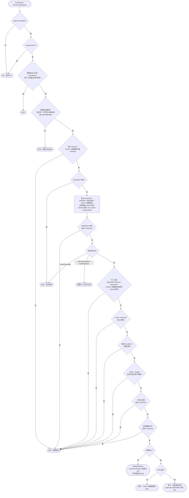

# 审批配置说明

wezard 的 PreToolUse 远程审批由 `~/.wezard/config.jsonc` 的 `approval` 段控制。本文覆盖审批粒度、规则与危险名单、完整判定链，以及几类「不走普通卡」的特殊调用。每个键的类型 / 默认值 / 说明可用 `config_get({path:"approval"})` 现查；`config.example.jsonc` 是带注释的样例。

## 审批粒度：`approval.mode`

一个枚举表达全部粒度（2026-10-28 起，原来的 `danger.enabled` / `danger.skip` / `danger.skipAll` 三个布尔已并入它）：

| mode | 语义 | 谁会收到卡片 |
| --- | --- | --- |
| `"danger"`（**缺省**） | 只有命中危险名单（`approval.danger`）或 `askRules` 的调用才发卡，其余静默放行 | 仅危险 / 你点名要问的操作 |
| `"all"` | 每个命中 `matcher` 的调用都发卡（`allowRules` / ⏱窗口 / 会话缓存可以豁免） | 所有工具调用 |
| `"skip_all"` | 一律放行、不发权限卡 | 没有人（见下面的边界） |

`wezard init` 只写 `approval.enabled` 与 `approval.matcher`，**不写 `mode`**，所以全新安装落在缺省 `danger`。想要「每次调用都点一下」就显式设 `all`。

`danger` 档的静默放行会顺手续一个 ⏱ 窗口（`windowMinutes`）用来记账，日志里能看出是窗口放的、不是无痕放行；窗口本身不参与门控。

### `skip_all` 的边界

「跳过所有审批」压过：危险名单、`askRules`、⏱窗口、会话缓存。以下**不受影响**：

- **`denyRules` 仍然拒绝**——拒绝不是审批，开关只决定「要不要发卡问人」，不解除显式禁令；
- **`EnterPlanMode` 拦截**（`blockAutoPlanMode`）仍然生效，同为 deny 语义；
- **`AskUserQuestion` 投票卡 / `ExitPlanMode` 计划卡照常发**——它们是交互桥（把 CLI 里的提问 / 计划呈现给远程的你），不是权限闸门，任何 mode 下都保留；
- **`.claude/**` 写守卫照常收尾**：放行后 daemon 仍会去 pane 代按 CC 的原生确认框，避免静默死锁（见下）；
- **外部接待 wizard 与 Codex 沙箱权限仍发卡**（见「特殊调用」）；**学徒**会话的豁免一律不生效，卡永远到人。

`skip_all` 与 `approval.enabled: false` 的区别：前者让 hook 明确回答 `allow`（CLI 不再弹任何确认）；后者回答 `ask`（wezard 不介入，退回 CLI 本地的权限系统）。

### 临时交回本地 CLI：`wezard use`

`wezard use cli`（IM 里 `/use cli`）把审批权交回本地 CLI：hook 一律零输出放行给 CLI 自己的权限框，daemon 也不再发卡；`wezard use wecom` 交回；无参看当前。它是 `approval.mode` 之上的运行时开关，状态存在 `<stateDir>/approval-mode`。

### 从旧版升级

老配置里的 `approval.danger.enabled` / `skip` / `skipAll` 不会报错：**未显式写 `mode` 时**，`skip` 或 `skipAll` 为 `true`、或 `enabled: false` 会被读成 `mode: "skip_all"`（daemon 日志给一条提示），其余落缺省 `danger`。「只豁免危险名单」那一档已不存在；改写成 `mode` 字段即可，旧键可以删。

## 命中危险名单意味着什么

危险名单不只是「会发卡」，它是一组更硬的约束（内置规则见 `daemon/danger.ts`：`find -delete` 批量删除、`truncate`、`git push --force`、`DROP TABLE`、数据卷删除、敏感路径等）：

| 约束 | 说明 |
| --- | --- |
| 逐次单独审批 | 不吃 ⏱ 自动放行窗口，也不吃会话缓存——同参数重复调用仍要再点一次 |
| 不参与批量合流 | 永远独占一张卡，不会被 `✅ ×N` 聚合掉 |
| 卡上只有 ❌ / ✅ 确认执行 | 没有「⏱ 自动过」「✅总是」两颗按钮 |
| 错误时降级为 ask | `fallbackOnError: "allow"` 对它无效：超时 / 无审批人交回本地 CLI，绝不静默放行一次强推 |

同一组约束对 `askRules` 命中、Codex 沙箱权限、外部接待 wizard 的调用同样成立——它们在判定链里合称 `mustCard`。

名单的定制在 `approval.danger`：`builtin`（`false` = 只用自定义规则）、`commandPatterns` / `toolPatterns` / `pathPatterns`（追加的 JS 正则，大小写不敏感）、`allowPatterns`（豁免，优先级最高；**粗粒度**：任一命令匹配，这次调用的全部危险规则一并豁免）、`credentialAllow`（只豁免「凭据文件」这一条规则，见下节）。`allowRules` / `denyRules` / `askRules` 用 Claude Code 风格的规则语法（如 `Bash(git log *)`），语法与示例见 `config.example.jsonc` 内联注释；优先级 `denyRules` > `askRules` / 危险名单 > `allowRules`，再宽的 `allowRules` 也放不过危险名单。

### 凭据文件规则与白名单 `credentialAllow`

内置「凭据文件」规则（`.env*`、`.npmrc`、`.netrc`、`.aws/*`、`.gnupg/*`、`credentials*`、`secrets.{json,yaml,env}`）按「动词 + 路径」判，只拦**会把内容带出来**的操作。`.env.example` / `.sample` / `.template` / `.dist` 一直放行。

| 放行（不发卡） | 仍然拦（发危险卡） |
| --- | --- |
| `ls` / `stat` / `file` / `md5sum` / `git ls-files` / `ln -s` / `cmp`（不带 `-l`）/ `diff -q` 等只看元数据的命令 | `cat` / `head` / `less` / 无打码的 `grep` / `sed` / `awk` 等把内容回显出来的读法 |
| **同名拷贝**：`cp ../x/.env .env`、`cp ../x/.env .`、`mv .env ../archive/`（名字不变，事后再 `cat` 这份拷贝仍会被本规则认出） | 改名（`cp .env notes.txt`）、目的地在 `/tmp` · `/var/tmp` · `/dev/shm` · `~/Downloads` · `/mnt` · `/srv` 等公开目录、`host:` / `user@host:` 形态、`$(…)` 动态拼接、先 `cd /tmp` 再拷、非凭据拷到凭据文件（`cp .env.example .env` = 写入）；`scp` / `rsync` / `tar` / `curl -d @` / `nc` 外发一律拦 |
| `grep "^\.env"` / `ls -a \| grep "^\.env"`（检索**模式**里写了 `.env` 不是在读它） | `grep KEY .env`（`.env` 是被读的文件操作数；引号里带 `\|` `)` 的模式也一样） |
| 下游已打码：`\| sed 's/=.*/=***/'`（替换段带 `*` / REDACT / MASK）、`\| cut -d= -f1` 只留键名、`\| awk -F= '{print $1}'`、`\| wc`、`\| sha256sum`；`U=$(grep ^DB_URL .env \| cut …)` 赋给变量且之后没把 `$U` 原样 `echo` / 外发 | 打码不实（`sed 's/a/b/'`、`cut -d= -f2`）、`echo "$U"` 把读到的值回显、`curl -d "$U"`、写入 / 重定向到凭据文件（`>` `>>` `tee` `sed -i`）、脚本里直接 `open('.env')`、ssh 远端的同类读法 |

局限（如实）：打码只按文字形态判，**验证不了** `sed` 替换是否真盖住了值（`s/x/*/` 也算）；`cd` 只识别「进公开目录」一种；`$VAR` 开头的路径解析不出。`Read` / `Write` / `Edit` 工具直接碰凭据文件始终发卡。

**白名单 `approval.danger.credentialAllow`**（缺省 `[]`，不预置）把指定的凭据文件从上表「仍然拦」里的**读 / 拷贝**那几类再挪出来，**只**豁免凭据文件这一条规则——SSH 密钥、提权、强杀、删除、`git push --force` 等其他规则不受影响；写入、外发、脚本直读永远照拦。条目有两种写法：

- 路径 glob 字符串：支持 `~` / `$HOME`；`**` 跨目录，`*` 不跨 `/`；相对路径按**这次调用的会话 cwd** 解析；命令里写成 `$VAR/.env`、`$(pwd)/.env` 的路径解析不出，不命中。
- 对象 `{ "path": "<glob>", "verbs": ["copy", "read-masked", "list"] }`，`verbs` 限定放行哪类操作，省略 = 三类全放：
  - `copy`：`cp` / `mv` 到任意本机位置（含改名、含 `/tmp`；不含 `host:`、动态拼接、写入凭据文件）；
  - `read-masked`：`cat` / `grep` 等读出内容，但管道链上须有 `cut` / `sed` / `awk`（或赋给变量且不回显）——**守护进程不验证这些下游参数**；原样回显照拦；
  - `list`：元数据类。默认已放行，写出来只为显式声明，目前没有额外效果。

```jsonc
"danger": {
  "credentialAllow": [
    "**/.wt/*/.env",                                   // 所有 worktree 的 .env: 拷贝 + 打码读 + 元数据
    { "path": "~/proj/.env", "verbs": ["copy"] }        // 这份只许拷贝
  ]
}
```

优先级：`denyRules` > `askRules` > 内置危险规则 > `credentialAllow`——白名单只让「内置凭据规则」不再命中，命中 `denyRules`（拒绝）或 `askRules`（每次问）的调用不因它而免卡；`allowPatterns` 仍是整条放行，更粗。**热生效**：经 `config_set` 修改立即生效，手改配置文件需 reload；改它属放权项，改动走人点卡。CodeBuddy 原生权限框的代按路径拿不到 cwd，那里相对路径条目不命中（绝对路径 / `~` / `**` 条目照常）。

### workspace 内放行 `workspaceAllow`

`find … -delete` / `find … -exec rm` 与 `truncate` 是目前仅有的「删除 / 覆盖」类命令规则（`rm`、`git reset --hard` / `clean` 早已不在名单里，不弹危险卡）。当这条命令里**每一处**该动作的目标都能静态确定地落在**该会话的工作目录（cwd）之内**时，这两条规则不再命中，不发危险卡（缺省开，`approval.danger.workspaceAllow: false` 关掉）。

判定是真解析，任何一条过不了就照旧发卡：

| 情形 | 结果 |
| --- | --- |
| 相对路径 / 绝对路径落在 cwd 内（`..` 先归一再比；`~`、`$HOME` 先展开） | 放行 |
| 符号链接指到 workspace 外（中间目录、终点文件、find 的搜索根都算；比较的是 `realpath`） | 发卡 |
| 带 `$VAR` / `$(…)` / 反引号 / 通配 `*?[]` / `{a,b}`、子 shell、`cd` 之后的相对路径 | 解不出，发卡 |
| workspace 根本身（`truncate .`）、任何 `.git` 内的目标、workspace 外的绝对路径 | 发卡 |
| `find` 无筛选条件（`find . -delete`、`-type f -delete`、`-name '*'`） | 发卡（等于清空整个 workspace 连同 `.git`）；带 `-name` / `-path` / `-newer` / `-mtime` / `-size` / `-empty` 等筛选才放行 |
| `find -L` / `-follow` / `-fprint*` / `-ok`，`-exec` 的不是纯 `rm` | 发卡 |

只摘这两条规则：同一条命令里别的危险动作（`sudo`、强杀、凭据文件、`DROP`……）照拦；`denyRules` / `askRules` 不受影响。已知取舍：带筛选的 `find` 从 workspace 根出发会遍历 `.git`，名字恰好匹配筛选的 `.git` 内文件也会被删——与 `.git` 作为直接目标被拦是两回事，要连这种也拦请关掉开关或用 `commandPatterns`。仅对带会话 cwd 的 hook 调用生效（CodeBuddy 原生框代按没有 cwd，不适用）。

## 判定链

每一次 PreToolUse 请求按下图自上而下走，命中任一出口即返回，后续分支不再计算（顺序即 `daemon/approval.ts` 的执行顺序）。多条不同理由的静默放行汇到同一个 `allow` 出口，区别只在日志里的 `reason` 字段：

图 1｜PreToolUse 请求的完整判定顺序



几处图里一眼看不出来的细节：

- **`.claude/**` 写守卫**（`claudeConfigGuard`，缺省开）不是图里的一个出口，而是挂在**每一条 allow 出口**上的收尾。原因：改 Claude 自己的配置面（settings / hooks / skills…）会让 CC 立起它自己的原生确认框，那个框**不经过 hook**——规则一放行就是「不发卡 + pane 无限期阻塞」。所以放行之后，daemon 去 pane 上代按这个框（`claudeConfigModalWaitMs` 内等它出现）；按不掉就 Esc 取消并把原因注入会话。只对有活 tmux pane 的镜像会话、且非 Codex 生效；它不改变是否发卡。
- **原生权限框代按**：CodeBuddy 等的「本地面板先行」里，你在卡上点过 ✅ 的调用，daemon 会替你按下 pane 里那个原生框，迟到的 hook 上报不再发第二张卡（图中「刚点过 ✅」）。代按成功后要不要往聊天里贴一条由 `approval.pressNotices` 决定：`off`（缺省，只写日志）/ `unseen`（只报入参没看全的）/ `all`。
- **`askRules` 不会被 `danger` 档顺带关掉**：只要有任何别的必发卡理由，`danger` 档的早退就不触发。
- **机器人断线不放行**：企微 WS 没连上时发不出卡，daemon 回 `pass`，hook 译成「什么都不答」——与 hook 够不着 daemon 同口径，交回 CLI 自己的权限流程（允许规则命中就跑，否则弹本地原生框），**绝不 allow**；危险名单 / `askRules` / `.claude/**` 守卫 / 普通工具一视同仁（Codex 见下：`PreToolUse` 没有 ask，普通工具被拒；沙箱权限回到 Codex 原生确认）。它不走 `fallbackOnError`，所以把 `fallbackOnError` 设成 `allow` 也换不来断线期间的放行。想让断线期间也由 CLI 全权处理，把 `approval.enabled` 设 `false` 或用 `wezard use cli`。
- **`set_model scope:"default"`**（改 CLI 全局默认模型）视同危险：必发卡，只有你开的 `skip_all` 与 bypass 压得过它；`config_set` 不走这里，见「运行时切换」。

## 特殊调用

**外部接待 wizard**（外部调用方的专属接待 wizard——`external.principals[].reception` 指定的，或首连登记时自建的 `ext-<名>`；由外部 agent 的请求驱动，见[技术说明](技术说明.md#外部-agent-接入wezard-ext)）：它的轮次里，除 wezard 自家工具（直接 MCP，或 REPL 脚本里只调 wezard / 纯计算）外，凡是 `matcher` 拦下的调用**一律单次发卡**——压过 `allowRules`、⏱窗口、会话缓存、`skip_all`、bypass 与 `danger` 档的早退；`denyRules` 仍然拒绝。卡面「审核」行写明「外部接待 <名> · 由外部调用方 <名> 的请求驱动」。

**Codex 的沙箱 / 网络权限请求**（`PermissionRequest`）：每次都单独发一张确认卡，不看 `matcher`，不吃 ⏱窗口、会话缓存、`skip_all`、bypass（`denyRules` 仍生效）；允许 / 拒绝会回传给 Codex。Codex 的 `PreToolUse` 不支持 `ask`，所以 daemon 断线、机器人断线或审批桥不可用时，普通工具请求被拒绝，沙箱权限请求则回到 Codex 自己的本地确认界面。

**管家手闸**（`daemon/steward-guard.ts`）排在 matcher 之前，只对群的管家会话生效：`Edit` / `Write` / `MultiEdit` / `NotebookEdit` / `Agent` / `Task` 一律拒（Bash 写文件同拦：sed -i / 重定向 / tee），读代码（Read / Grep / Glob 及 cat / grep / git show 等只读命令）放行且不计数，其余跑命令每轮最多 `chatPolicy.<群>.stewardBudget` 次（缺省 4，`-1` = 关），wezard MCP 与 ToolSearch 等元工具不计。它拦的不是危险而是越位，所以 ⏱窗口、`allowRules`、`skip_all` 都压不过它；deny reason 直接告诉管家去 `delegate`。新群的引导会话与 perceptron 等**受限会话**更严：只放行各自声明的几个 wezard 工具，其余一律拒。

### 子代理 (subagent) 的审批归属

CC / CodeBuddy 的子代理（Task/Agent 工具 spawn）在内部做工具调用时同样触发 `PreToolUse` hook。两者默认把 hook 的 `session_id` 上报成**父会话** id，所以子代理工具调用天然与主会话走同一套判定链——`skip_all` / 卡片 / ⏱窗口 / 会话缓存 / 规则全部适用，无需额外配置。

少数 CC 版本 / IDE 集成会上报子代理**自己**的 session id。该 id 未镜像绑定且能通过 transcript 反推出父会话时，daemon 把请求路由回父会话的 chat，保证卡片发到正确会话、开关照常生效——而不是落到 `ask` 兜底变成 pane 里远程无人可点的原生确认框。反推不到父会话、又没有审批人时，子代理请求返回 **deny + 原因**而非 `ask`：无人值守的子代理收到 `ask` 会永久挂起，deny 至少把「缺审批人」带回对话。

一个不受 wezard 约束的例外：子代理（或整个会话）被显式配置成 `bypassPermissions` / `fullAccess` 时直接放行——那是你显式选了「全跳过」。

## 卡片

| 场景 | 按钮 |
| --- | --- |
| 普通调用（`all` 档） | `❌` · `⏱<窗口>自动过` · `✅总是`（生成一条 `allowRules` 并落盘） · `✅` |
| mustCard（危险名单 / `askRules` / Codex 沙箱 / 外部接待） | `❌` · `✅ 确认执行` |

窗口时长取 `approval.windowMinutes`（缺省 600 分钟，按钮上渲染为 `⏱10h自动过`）。发卡前 `sensitiveArgRedact`（缺省开）会先给参数里的密码 / token 脱敏，卡片与详情页只留脱敏形态；同会话同工具的并发调用在 `batchCoalesceMs` 内合成一张批量卡。卡片引用区最多 `cardQuoteMaxChars` 字，完整命令点进详情页或「📄 展开完整命令」看。

## 配置键速查（`approval.*`）

| 键 | 缺省 | 作用 |
| --- | --- | --- |
| `enabled` | `true` | 审批总开关；关 = hook 回 `ask`，退回 CLI 本地权限流 |
| `mode` | `"danger"` | 粒度：`all` / `danger` / `skip_all` |
| `matcher` | `".*"` | 哪些工具名进入审批（正则） |
| `approvers` | `[]` | 可以点卡的人；空 = 不限 |
| `allowRules` / `denyRules` / `askRules` | `["ToolSearch","mcp__wezard"]` / `[]` / `[]` | 规则；显式写 `allowRules` 会**整份覆盖**缺省值 |
| `danger` | — | 危险名单：`builtin` · `commandPatterns` · `toolPatterns` · `pathPatterns` · `allowPatterns` · `workspaceAllow`（缺省 `true`，workspace 内的 find 批量删除 / truncate 免卡）· `credentialAllow`（凭据文件白名单，缺省 `[]`） |
| `windowMinutes` | `600` | ⏱ 窗口时长（分钟） |
| `sessionCacheMinutes` | `30` | 同会话重复调用沿用上次决定的分钟数 |
| `longPollSec` / `hookTimeoutSec` | `43200` / `43210` | 卡等待点击的上限 / hook curl 超时；后者必须严格大于前者，否则人还没点 hook 就先回了 `ask` |
| `fallbackOnError` | `"ask"` | 审批链出错 / 无审批人 / 超时时 hook 的回答：`ask` / `allow` / `deny`（`mustCard` 时 `allow` 降级为 `ask`） |
| `sensitiveArgRedact` | `true` | 发卡前脱敏参数 |
| `batchCoalesceMs` | `250` | 并发调用合成批量卡的窗口，0 = 关 |
| `blockAutoPlanMode` | `true` | 拦截模型主动调用的 `EnterPlanMode` |
| `claudeConfigGuard` / `claudeConfigModalWaitMs` | `true` / `4000` | `.claude/**` 写守卫 / 等原生框出现的最长毫秒数 |
| `pressNotices` | `"off"` | 原生框代按成功后的聊天通知：`off` / `unseen` / `all` |
| `cardQuoteMaxChars` / `fullCommandPreludeChars` | `1200` / `0` | 卡引用区字数上限 / 长命令发卡前先推全文的字数上限（0 = 关） |

## 运行时切换

IM 里直接对 Agent 说人话，它调 MCP `config_set({path, value})`：

| 说 | 效果 |
| --- | --- |
| 「只审危险操作」 | `config_set({path:"approval.mode", value:"danger"})` |
| 「每次调用都要我确认」 | `config_set({path:"approval.mode", value:"all"})` |
| 「跳过所有审批」 | `config_set({path:"approval.mode", value:"skip_all"})` |
| 「这类命令以后都放行」 | `config_set({path:"approval.allowRules", op:"add", value:"Bash(git log *)"})`（在卡上点 `✅总是` 也会生成一条） |

`approval.*` 属于**放权项**：守护进程自己推一张确认卡，人点了才落盘——确认卡不经 hook，所以 `skip_all` 也压不过它；卡在请求里等 4 分钟，之后回 pending，迟到的确认照常落盘。落盘经 zod 整份校验、保留 `config.jsonc` 的注释，内存同步更新，`wezard reload` 后仍保持。先 `config_get({path:"approval"})` 看每一项的当前值、默认值与说明；`dryRun:true` 预演改前改后的 diff。
