# wezard 技术说明

面向想搞清楚内部机制的读者：消息如何双向同步、`.name` 如何路由、公开频道与私聊怎么分、管家如何分派、wizard 之间如何编排与收回执、顶层模式管住了什么、rolepage 怎么从 turn 记录折出一个 wizard 的 IM、缓存冷热如何判、文档 MCP 如何桥接、整体架构长什么样。上手用法看 [README](README.md)，审批粒度看 [审批配置](审批配置.md)，模块级职责看 [CLAUDE.md](CLAUDE.md)。

---

## 架构一瞥

三个进程走 `127.0.0.1:17890` + `~/.wezard/`。daemon 是**唯一**持有 WeCom WS 连接的进程，hook 和 MCP 都是它的薄 HTTP 客户端：

图 1｜三进程与它们之间的四条通路

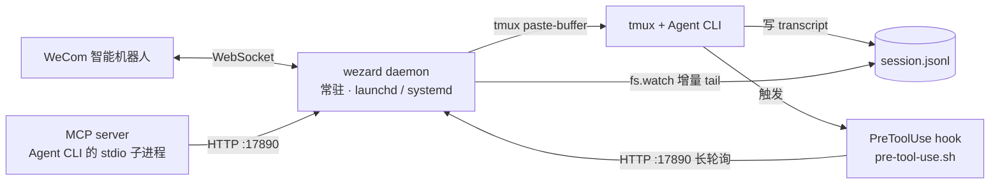

---

## 消息是怎么同步的

**审批流**（工具调用审批都走这条）。hook 的 curl `--max-time` 必须严格大于 `longPollSec`，否则人还没点、hook 已经自己回了 `ask`：

图 2｜一次工具调用从阻塞到放行

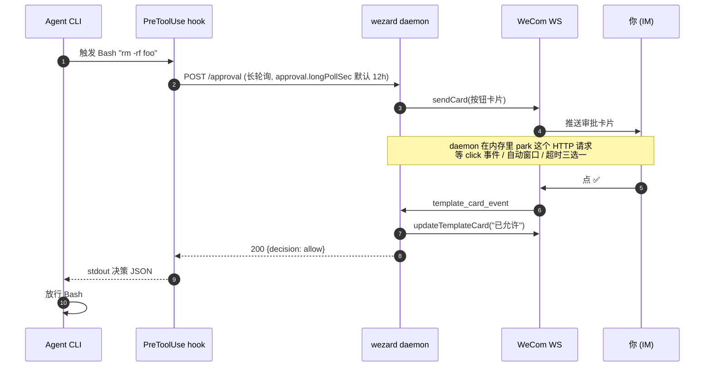

**镜像流**（IM ↔ tmux 双向）：

图 3｜一条 IM 消息进 CLI、再流式回到 IM

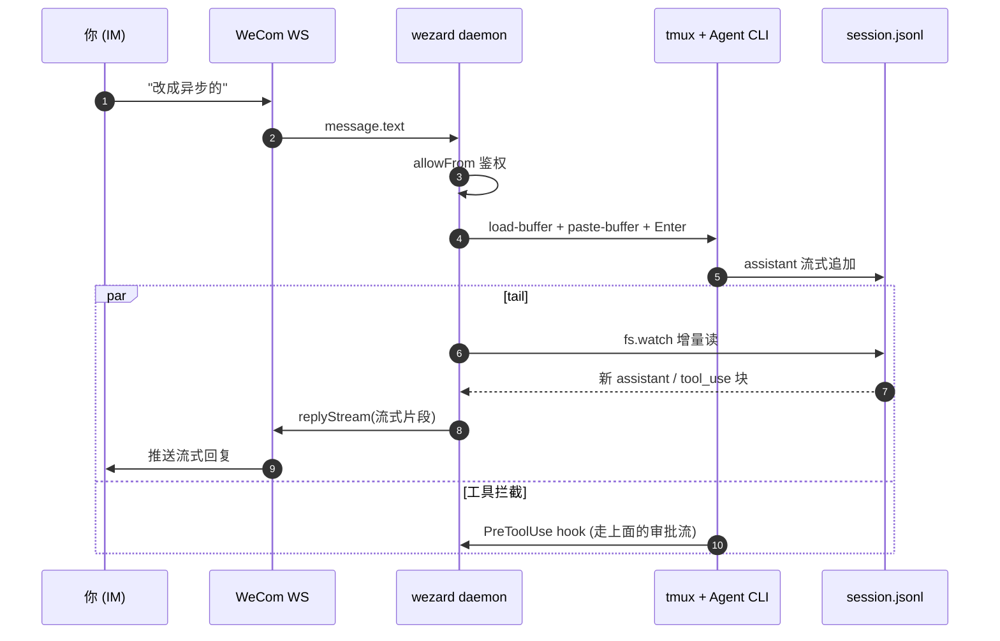

两条流的共同要点：

- 审批是**长轮询 + 内存 park**，没有 webhook、不依赖外网回调；
- 镜像是**单向 paste + 单向 tail**：IM→tmux 走粘贴键，tmux→IM 走读 jsonl，两条管道独立、互不阻塞。

---

## 多会话路由（`.name` · 频道 · 聊天命名 · 多 CLI）

一个 wizard 有两个身份，各管一件事：

| | 形态 | 管什么 |
| --- | --- | --- |
| **会话 key** | `user:<id>` / `chat:<id>` + 可选 `#slot` | 内部路由与落盘：pane、jsonl、cwd 都挂在它上面。base 部分就是它的 **home 群** |
| **名字** | `.name`，全局唯一，存在 `wizards.json` | 人和模型看得见、写得出的唯一地址 |

默认会话（无 slot）的名字取聊天名，其余取 slot id；撞名由 `pickName` 加 `-N`（大小写不敏感）。名字惰性落定——`settleName` 在第一次被问到时 claim，`settleAll` 在 boot 时按「默认会话先挑、其余按出生先后」把名册一次补齐，老记录（名字还跟着聊天走的那一代）就在这里迁完。**改名只改名册，不动 key**：pane、jsonl、历史都不受影响。

路由全部发生在 daemon 侧，tmux pane 无感知：

图 4｜一条入站消息如何落到某一个 wizard

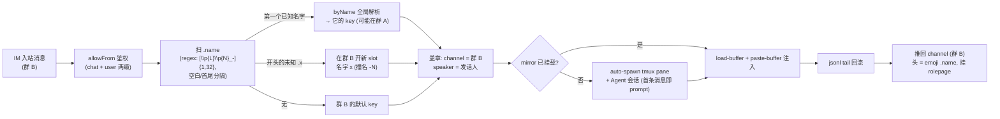

关键规则：

- **名字全局可达，回复回发话群**：人在群 B 里 `.fix`，而 `.fix` 的 home 是群 A——本轮 `recordTurnStart` 记下 `channel = 群 B`，回复（流式 / standalone）连同本轮的审批卡、提问卡都推回群 B。在 home 群说话照旧，`channel` 就是 home。
- **只有开头的未知名字会造人**：句中一个没人叫的 `.x`（`a.ts`、`.gitignore`）原样透传，只有消息开头的那个才在本聊天开一个新 slot。名称只按全局名册解析；新建 slot 避开已有身份占用，不再按旧同名 slot 回退唤醒会话。
- **引用即路由**：出站气泡使用当前 `.name:`、反引号署名或链接头，由 `parseTagHeader` 反解；当前 `✦` footer 通过稳定 role key 识别发话方。引用一条气泡 = 跟那个 wizard 说话；旧 `#tag`、emoji/箭头头部及旧本地 slot 回退不再识别。
- **cwd 是聊天级的**：同一聊天（home）里的所有会话共用一个 cwd；换项目走 `set_workspace` MCP，daemon 内部即 `setPendingCwd` + 自动交接（写简报 → 重开落进新目录 → 简报贴回，上下文带过去），聊天层一步生效。
- **聊天名是另一层地址**：`notify` 往哪个群发、`spawn_wizard({chat})` 把 home 设在哪个群，写的是聊天名；它同时是这个群默认 wizard 的名字——人 `/name` 改聊天名时默认 wizard 一并改名，tmux 窗口名跟着换。没名字的聊天按工作区末段自动补一个（`~/develop/Guxi11/weclaude` → `weclaude`，撞名加序号），补名点是「要把名字交给模型」的那一刻——各 MCP 路由的收件解析，以及**渲染 charter 时**：系统提示随进程终身，一个在聊天还没名字时出生的 wizard 会一辈子以为自己住在「(未命名)」的地方。只填空，永不覆盖人起过的名字。
- **多 CLI 并存**：会话身份就是 jsonl 路径，daemon 由路径反推写它的 CLI，`--resume` 二进制、jsonl schema、project-dir 编码全部由此派生；新 pane 统一取 `wrc.defaultCli`，当前 `/new` 不再按单次参数选择 CLI；原生 clone 的后端约束仍按父 transcript 处理。

---

## wizard 网络：身份、感知、分派、编排

一个绑定了聊天的会话就是一个 **wizard**。它要协作，就得知道自己是谁、记得住跨会话的东西、知道网络里还有谁，还要有一套把活分出去再收回来的原语。每样各有各的通路，共同的约束只有一条——**不许多花轮次**：身份走系统提示，名册变动搭顺风车，回执作为新的一轮自己回来，没有一样是靠「先问一句」换来的。

| 小节 | 解决的问题 | 落在哪 |
| --- | --- | --- |
| [身份](#身份系统提示不是聊天记录) | 它是谁，`/clear` 之后还记不记得 | `wizard.ts` |
| [记忆](#记忆三个作用域共享的那两份只有一个写入者) | 跨会话、跨 wizard 共享的那些约定 | `wizard-memory.ts` · `memory-steward.ts` |
| [分身](#分身fork-上下文不是新开一个) | 公共材料读一遍，分出 N 路 | `mirror-bridge.ts` |
| [感知](#感知快照--增量) | 名册只会越来越假 | `notices.ts` · `peers.ts` |
| [分派](#分派默认-wizard-是这个群的管家) | 没点名的活该给谁、用哪一档模型 | `route.ts` · `steward-guard.ts` |
| [编排](#编排控制流留在发起方) | owner 维护的多 plan DAG、消息关联与提醒 | `plans.ts` · `plan-http.ts` · `plan-reminders.ts` |
| [回执](#回执持久路由与证据恢复) | 派活、结果归属与跨重启恢复 | `router.ts` · `message-events.ts` · `pending-items.ts` |
| [交接](#交接换会话不换身份) | 上下文大了怎么原地重开 | `handoff.ts` |

### 身份：宪章快照与后端注入

身份（全局名字、工作区、职责、记忆、家谱、工具清单、编排剧本、公开与私聊的规矩）由 `wizard.ts` 的 `renderCharter` 从注册表渲染。Claude/CodeBuddy 通过 `charterPending` 在首条非 slash 注入前放入 preamble，确认提交后清标记；`/new`、`/clear`、交接与上下文切断按需重新武装。Codex 使用当前调用的 `developer_instructions`。不再用 `--append-system-prompt` 固定旧宪章。注册表是一份写穿 json（`~/.wezard/wizards.json`），由 `bindWizardStore` 绑成进程内单例，IM 侧的 `/peers` 也读得到。

图 5｜charter 按当前后端注入，清上下文后重新武装

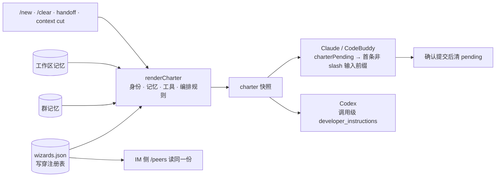

### 记忆：三个作用域，共享的那两份只有一个写入者

`wizard_remember({scope})` 写三种记忆，区别不在存哪儿，而在**谁能写**：

| scope | 存在哪 | 生效 |
| --- | --- | --- |
| `self`（默认） | 它自己的名册记录（`wizards.json`） | 当场 |
| `chat` | `~/.wezard/memory/chats/<home>.md` | 提议，等整理者合并 |
| `workspace` | `~/.wezard/memory/workspaces/<cwd 编码>.md` | 提议，等整理者合并 |

自己的记忆跟着自己走，直写即可。可很多东西不属于某一个 wizard——「这个群里人习惯先出方案再动手」属于这个群，「这个仓库没有测试、reload 要先 build」属于这个工作区。这两份是**共享**的 markdown，任何以那个群为 home、或在那个目录下出生的 wizard 都把它们读进 charter，于是新来的不必被人再教一遍。是 md 而不是 json：人也会直接打开改。

共享的那两份**不直写**。`wizard_remember({scope})` 只往同名收件箱（`memory/inbox/<chats|workspaces>/<key>.jsonl`）追加一行 json 提议（`{at, by, note?, forget?}`）——一行一条、追加写，几十个 wizard 并发投也不会互相覆盖。直接追加的老路在几十个 wizard 同写一份文件时只会越来越长、互相矛盾，而每个新 wizard 出生都要把它整份吃下。

图 6｜共享记忆的单写入者：提议进收件箱，整理者合并进 md

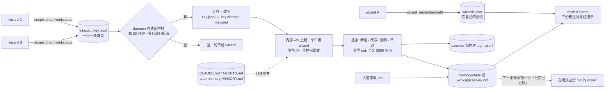

**整理者既不是常驻 wizard，也不是一条定时任务**，是 daemon 的内建定时器（`memory-steward.ts`，每 30 分钟，开机后 1 分钟先跑一轮）。它看收件箱有没有提议，有才在一个**不属于任何聊天**的内部 key 上起一个白板 wizard 去合并，合并完即收。整理不放进管家的上下文——管家的上下文只留给名册和分派；这是 Letta 把 sleep-time agent 与主 agent 分开的同一个理由：在线的那个不该被后台活拖慢。不走 `tasks.ts` 是因为它不是谁排的日程：任务会出现在 `list_tasks` 和日程里、放枪要发 ⏰ 气泡、执行体住在某个群里，而整理是 daemon 自己的家务，不该惊动任何群——全程零气泡，结果只留在执行体的 rolepage 和审计日志里。老版本写下的 `memory-steward.task.mjs` 开机时改名为 `.retired` 停用，免得两路并跑。

- **认领 = 改名**（`x.jsonl` → `x.claimed-<ms>.jsonl`）：认领之后新来的提议落进一个新的 `x.jsonl` 等下一轮，不会和正在合并的那批搅在一起。整理者中途死掉留下的认领超过一小时再认一次——按**文件名里的时刻**判，不按 mtime（改名不动 mtime）。
- **合并规则**：逐条决定新增 / 改写（新的更准，或推翻了旧的）/ 删除（`forget` 命中，或已被推翻、过时）/ 不动（重复、只是某次任务的临时状态，或参考文件里已经写了）；重写 md，每条一行，相近的合并，全文 3000 字以内，人手写的内容与格式保留。收工后由 daemon 把收件箱归档进 `log/` 再删——执行体只动 md。
- **参考源只读**：该工作区的 `CLAUDE.md` / `CODEBUDDY.md` / `AGENTS.md` / `.claude/CLAUDE.md` 与各 backend 的 auto-memory `MEMORY.md` 一并交给执行体。已写在那里的不再收；与之矛盾的提议不进 md，记作冲突——参考文件是人写的，优先。workspace 提议记下 `cwd`，提议者收工后仍找得到参考源。
- **合并后告诉在场的**：宪章是出生快照，改了 md 活着的 wizard 也看不到。真有改动时，pane 活着且读这份 md 的 wizard 下一条消息尾巴上捎一行「记忆已更新，全文见 …」。
- **宪章里每份共享记忆截到 4000 字**（`CHARTER_MEMORY_MAX`），超了只截头并指路全文——压短是整理者的活，不是渲染器的。

读写失败一律吞掉：记忆是锦上添花，读不到就当没有，写不进就回报失败，都不该拖垮一次 spawn。

### 分身：fork 上下文，不是新开一个

`MirrorBridge.cloneSession` 走 `--resume <父 sid> --fork-session`：CLI 把父亲的 transcript 复制一份再往下写，孩子开局就带着父亲读过的一切，父亲毫发无损。**「公共材料读一遍，再分出 N 路」靠的就是这个。** 两条不变式：

- `--fork-session` 是强制的——少了它，第二个 pane 会追加进父亲的 jsonl，两个聊天当场串线；
- fork 出来的 transcript 只在那个 pane **收到第一条消息**时才出现，所以分身的开场白就是触发器，attach 会等这个 fork；等不到就杀掉 pane，绝不退而绑到父亲的 sid 上。

图 7｜带与不带 `--fork-session` 的分歧

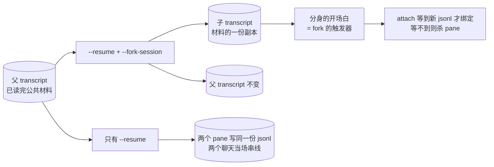

### 感知：快照 + 增量

charter 里那份名册是 spawn 那一刻的快照，只会越来越假；而「每次协作前先查一次名册」要花一轮，于是实际上没人查。所以补上另一半：

图 8｜名册变动怎么搭顺风车进到别人耳朵里

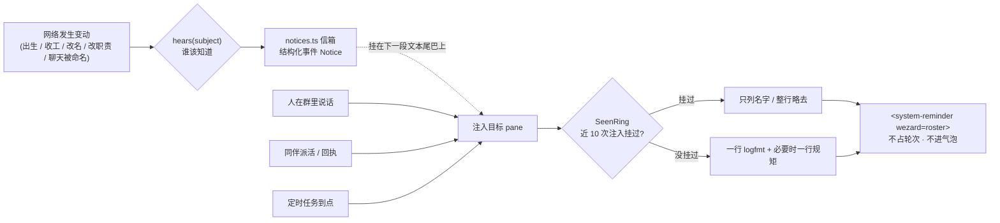

- **事件是结构化的**（`Notice`），渲染成一行 logfmt：`born .x by=.p clone job=… cwd=…` / `ended` / `renamed` / `job` / `chat` / `note`。工作区与收件人相同就不提；两次注入之间生了又收掉的净值为零不报；同一位收掉的一批分身并成一行 `ended .a .b .c …(+N) by=.p`。
- **谁该知道**由纯函数 `hears(subject)` 按注册表定：没有 parent 且写了职责的长住 wizard，告诉同群全体；有 parent 的只告诉直属 parent，不上溯家谱；既无 parent 也没写职责的（还没自我介绍的会话）谁也不告诉，写下职责那一刻才算登场。回归测试那一批临时分身因此不再刷别人。
- **去重窗口**：每个 pane 记着「近 10 次注入挂过哪些提示」（`SeenRing`，落盘 `~/.wezard/notice-seen.json` 扛 reload；换 sid、`/clear`、压缩、新宪章即清零）。窗口里介绍过的 wizard 只列名字，同一行变动不再重复，每段的使用规矩只在窗口里没给过时挂一行。一条点名 + 十几行分身生收的尾巴由约 810 tok 压到约 125 tok。
- **群况快照**（`mode="full"`）：只报变动的话，管家和长住 wizard 几乎收不到什么。所以长住 wizard（没有 parent 的）在近 10 次注入里没拿到过群况时，尾巴上挂一份 CSV 群况表 `name,state,job`——管家、长住有职责的、管家生的、收件人自己生的；忙闲取注册表，不抓 pane。交接 / `/clear` 后的头一条必带。
- **点名**（`wezard="mention"`）：消息里点到的 `.x` 每个一行 `.x job=… [chat=…] [cwd=…]`，窗口内再点同一个只剩名字。
- **挂起事项**（`wezard="pending"`，只给管家）：见[回执](#回执持久路由与证据恢复)一节的持久路由说明。

每条 reminder 的事实都写在开标签属性上（`wezard=envelope|mention|roster|pending`、`kind` / `from` / `chat` / `scope`），正文只给模型读——改措辞不会破坏解析（`shared/reminder.ts` 的 `parseEnvelope`）。投递即清空信箱：那一次注入失败这几行就丢了。通知是提示，真相永远可以 `wizard_roster` 问到——为一行提示做可靠投递不值当。

`wizard_roster` 自己则是一张**索引**而不是一份转储：服务端按 `query`（名字/职责/地址子串）、`cwd`（工作区反查）、`chat`、`alive` 过滤，默认只回最相关的一页（自己 → 活着的 → 最近动过的），附 `total` / `matched` / `more` 让调用方知道自己看的是不是全部。三百个会话一次吐出来，等于找不到人。

### 分派：默认 wizard 是这个群的管家

聊天的默认会话（`WizardBrief.steward`）是这个群的**管家**：人没点名说的话都落到它这儿，点了 `.name` 的直达那个 wizard，不经过它。`renderCharter` 只给它多压一段「我是这个群的管家」，所以管家不是另一种进程，只是多了一段职责。

它的活是**分派**，不是亲手干——上下文留给名册和来龙去脉，别被大段代码和文件塞满。一两句能答完的（问进度、问谁在干什么、闲聊）自己答；要读很多代码、改文件、跑很久的活，哪怕它自己做得了也转出去：它一忙，这个群里没点名的话就都排在它后面。

主路径是一步 `delegate({task, name, description})`：查候选 → 给默认决定 → 以管家的名义 `tell_peer` 投出去，回包写明决定、理由、件号与落到的模型。管家照办，或显式推翻——`to` 点名、`spawn:true` 硬要新的、`force` 越过冷门控、`tier` 换档。只想看证据自己判断时调 `route_candidates({task})`，拿到的是同一张表。

**`route.ts` 把这件事拆成能算的事实与必须判断的权衡。** 候选表只摆事实；`decide` 再把同一套事实收成一个默认决定——管家判断失准也不至于派错的那一半。

图 9｜候选表算到哪一步为止，剩下的交给管家

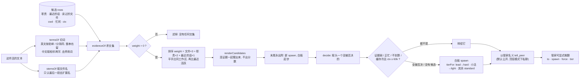

- **能算的**：职责 / 最近的话与这件活的词面交集；它上下文里读过的文件被这件活点到；在不在同一个工作区、忙不忙、`ctx` 多大、缓存冷没冷。
- **文件只认整个文件名被点到**：目录名（`daemon/`、`web/`）几乎每个文件都带，文件名里的半截词（`role-render` 的 `render`）又太常见——撞上它们说明不了它读过这一个。
- **排序只是让最有证据的先被看到**：文件命中（它真读过）> 职责 > 最近的话，同工作区只用来打破平手。权重为 0 的直接滤掉。
- **每个候选附一行代价**：缓存冷热（TTL 读自它 transcript 实际写入的档位，起点是最近一次请求的开始，见[冷热判定](#缓存冷热判定路由冷门控)）、唤醒要重写多少缓存（对比白板 spawn 起步约 25k 的倍数）、往后每轮背着的 ctx。证据弱又贵（缓存冷且 ctx ≥60k，或热但 ≥150k）的标 ⚠「不划算，建议白板 spawn」；看着是小活（一句话 / 样式 / 单点修改 / 简单查询）的表头点明。
- **末尾永远留着「新 spawn」**：它是没有好候选时的默认，所以表空了也不必特判。

`decide` 的否决按顺序判：**证据弱**（没读过点到的文件，职责也没撞上两个以上的词）→ **正忙** → **不划算**（上一条的 ⚠）→ **缓存冷且 ctx ≥60k**（`force` 可越过）。头一个没被否决的就是它；全被否决就白板 spawn，理由里写前几个为什么不行。spawn 的默认档由 `tierFor` 定，两头的 `mini` / `ultra` 只由调用方显式给。

留给管家的恰好是算不出来的那两件，推翻默认决定时用得上：

| 判断 | 依据 |
| --- | --- |
| **相关性** | 表里的交集是不是真的同一件事。字面沾边不算；文件命中比词面重叠可信。 |
| **接着用这段上下文划不划算** | 收益是它省掉的重读（要重读的材料越多越划算）；代价是唤醒时的缓存重写，以及 `ctx` 越大往后每一轮都背着整段历史——更贵、更慢、更容易被旧话题带偏、离交接越近。 |

**冷门控**：这笔账不只管家要算。任何 `tell_peer` 派新活（`kind:"task"`、不带 `re`、`priority` 不是 `now`）给缓存已冷且 ctx ≥100k 的 wizard，守护进程先不投，409 退回一行「`.x` 冷 · ctx Nk · 唤醒约等于白板 spawn 的 M 倍」；真依赖它的上下文就带 `force:true` 重发。冷热与倍数与候选表同一把尺（`wakeCostOf`）。

**档位**（`models.backends.<backend>.tiers`，由轻到重；表中为 Claude 系缺省）：

| 档 | 缺省 | 用途 |
| --- | --- | --- |
| `mini` | haiku · low | 机械一步，照单执行 |
| `light` | sonnet · medium | 跑腿：查找、搬运、跑命令 |
| `standard` | sonnet · medium | 常规实现 |
| `hard` | opus · high | 要判断：设计、排障、审查 |
| `ultra` | opus · max | 最难的架构取舍、疑难排障、关键评审 |

`spawn_wizard` / `clone_wizard` / `delegate` 都收 `tier`，显式 model / effort 压过档位，返回里每项写明来源（`explicit` / `tier` / `inherit`）；CLI 统一取 `wrc.defaultCli`。模型名能确切对上本机 transcript 里真答过的 id 时直接 `--model <id> --effort <档>` 启动，省掉 `/model` 选择器那一来回。Codex 使用独立档位，缺省模型留空交给 CLI，effort 依次是 low / medium / medium / high / xhigh。管家唯一档位来源是 `models.router`（缺省 `standard`），首建、`/new`、交接与冷恢复均按实际后端的档位表解析；已在跑的会话不自动换模型。旧顶层 `models.tiers`、steward 覆盖和档位内 `cli` 不再参与解析。

**复杂的活交给 lead**。管家用 `delegate({lead:true, task})` 将整件任务交给 lead；lead 维护自己的 plan，逐阶段安排 explorer、coder 与独立 reviewer，读回结果并验收后再推进 DAG。范围清楚、低风险 coding 默认 `light`；reviewer 从白板起步，按风险选 `light` / `standard` / `hard`。`renderLeadPlaybook` 随派活信封说明这些职责，不再开工单或预建后续执行队伍。

**手闸**（`steward-guard.ts`）：宪章说分派，管家实际上常常自己埋头干——一忙，群里没点名的话就全排在它后面。守护进程在 PreToolUse 判定链的最前面拦它（排在 matcher、allowRules、⏱ 窗口、`skipAll` 之前，拦的不是危险而是越位）：`Edit` / `Write` / `MultiEdit` / `NotebookEdit` / `Agent` / `Task` 一律拒（Bash 写文件同拦）；读代码（Read / Grep / Glob 与 cat / grep / git show 等只读命令）放行、不计数；其余跑命令每轮最多 `chatPolicy.<群>.stewardBudget` 次（缺省 4，`-1` = 关），超了拒；wezard MCP 与 ToolSearch 这类元工具不计。deny 的 reason 直接写改道说明：去 `delegate`。

### 编排：控制流留在发起方

Wezard Teams 将复杂任务保存为 **owner 自己维护的可变 DAG**。一个 wizard 可以并行拥有多个 plan；每个 plan 只有一个 owner，其他 wizard 只能读取。daemon 提供持久化、结构校验、查询与提醒，任务拆分、派发、验收和状态推进由 owner 显式完成。

图 10｜owner 逐阶段更新 plan 与安排协作

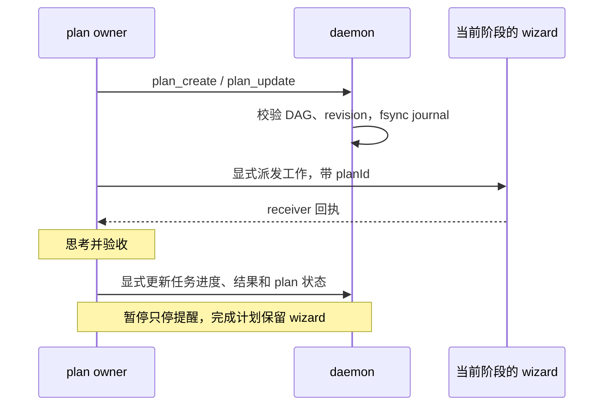

#### 数据与接口

`shared/plan.ts` 定义 `PlanRecord`、`PlanInput`、`PlanUpdate` 与校验器。plan 保存 id、owner、title、description、tasks、state、reason、revision、创建/更新时间，以及创建时的回复上下文 origin 和内部提醒标记。每个 task 保存 id、title、description、dependsOn、status、progress、result；不绑定 executor 或 attempt。

| MCP 工具 | HTTP 路由（POST） | 契约 |
| --- | --- | --- |
| `plan_create` | `/plans/create` | 创建调用者自己的 active plan，revision 从 1 开始；可先建空 DAG。可选 requestId 在 owner 内幂等，同 id 不同内容返回 409 |
| `plan_get` | `/plans/get` | 按 planId 只读获取完整 DAG；读取限制在同一 bot |
| `plan_list` | `/plans/list` | 默认列自己的 plans；可按 wizard name 只读查询同一 bot 的其他 owner |
| `plan_update` | `/plans/update` | 仅 owner 可写，revision 必须等于当前版本；tasks 替换整份 DAG。接受的更新使 revision 加一 |

计划状态为 `active`、`paused`、`completed`、`canceled`；任务状态为 `pending`、`in_progress`、`completed`、`canceled`。校验拒绝重复节点、缺失依赖、自依赖与环；将任务推进到进行中或完成时，它的前置任务必须已完成。plan 只有在全部任务完成或取消后才能标为 completed；completed/canceled 是终态，之后不再更新。owner 用 `plan_update` 显式暂停、恢复、完成或取消，取消独立于完成。

`daemon/plan-http.ts` 读取绑定 pane 优先、sessionId 次之的调用身份；拒绝 target-only 与冲突 target。创建还要求 owner 仍在注册表中且未进入退役。MCP 使用 `PlanUpdateSchema.innerType().shape` 暴露字段，HTTP 的 `safeParse` 保留业务 refine 校验。

#### 持久化与故障隔离

`daemon/plans.ts` 的 `loadPlans(cfg.wrc.mirror.plansFile)` 读写追加式 JSONL journal，默认 `~/.wezard/plans.jsonl`。create、update、reminded 均先写 journal 并 fsync，再发布内存状态；提醒标记单独落盘，不改变 revision。回放验证 owner、origin、版本与状态，已验证的完整行可恢复，末尾不完整写入才截断。坏的完整历史、初始化失败或写入失败使 store 不健康，计划读写与退役检查返回 503，不把部分回放或空集合当成计划事实，也不覆写坏 journal；普通 receiver 服务仍可运行。世界投影仅在 store 健康时读取 plans。

origin 由创建入口记录 channel、asker 和当时有效的 serves route，用于提醒后的回复上下文；它不建立 plan 关联，也不计作 plan 的欠账。

#### 逐输入关联与提醒

- 首次为 plan 派出的消息显式带顶层 `planId`，关联保存到每个 message event 的 payload。续问可继承原输入唯一的关联；一笔 receiver 欠账涉及多个 plan 时，未指定 planId 的普通消息仍照常投递，不猜关联。
- planId 只参与计划提醒。不同 plan 的输入仍按现行 receiver 规则合并，各自 payload 与 inputIds 保留；它不建立第二份欠账，不改变同 owner/receiver 只有一件 unfinished task 的约束。
- `daemon/plan-reminders.ts` 默认每 30 秒检查 active plans：owner 正忙、正在交接、已有待投提醒或这个 plan 的外派关联欠账仍未结束时暂不提醒。欠账按 `receiver.to === plan.owner` 及逐输入的 planId 识别，不把其他人派给 owner 的来件算作它的外派欠账。
- token 由 plan id、revision 和关联事件/route 状态快照生成；同一标记复用稳定的提醒 event。投递前再次同步校验 plan 状态、版本、欠账与 token；暂停、结束或版本变化使旧提醒失效。暂停不挡普通消息、回执或协作。
- 入队后持久化提醒标记。明确未暴露、可重试且非 uncertain 的投递失败继续复用同一 queued event，backoff 封顶 60 秒；possible exposure、submitted 或 uncertain 不盲目重投。这个分支不改变其他 receiver 重试行为。

#### 管理树与生命周期

spawn/clone 的 parent 始终是调用者；跨 cwd/chat 创建、从其他 wizard fork 上下文也一样，forkOf 只记录上下文来源。wizard 可以直接横向沟通与返修，随后回到自己的主流程交付；管理归属仍按直属 parent。结束身份只允许本人或直属 parent，忘记 parent 前先处理直属子 wizard。

交付后默认保留 wizard，结束 plan 也不自动收队。pane 数量超限时只收 pane，保留身份、会话绑定、plans 与 receiver 状态。任何逻辑退役路径都要检查未结束 plan；active/paused plan 阻止身份删除。退役集合与创建入口共同封住异步 killPane 期间新建 plan 的竞态，自动 runner 清理、releaseSlot 与记忆整理者清理也遵守同一保护。

旧 jobs、workflow nodes/plans runner、graph 执行器及相应 MCP/HTTP 入口已删除；没有旧 runner 兼容入口或数据迁移。`jobsFile`、`receiptsFile` 不再是配置项。peer 请求中的 job/node/role/workflow/graph/detached 等退役字段明确拒绝。关系图仍保留，通用等待 helper 迁到 `daemon/wait-idle.ts`。

### 回执：持久路由与证据恢复

`daemon/router.ts` 是 receiver task 的唯一账本。每行以 event 标识一件任务，记录 owner（当前执行并欠答的一方）、receiver（结论与追问的接收方）、状态及可选 batch 关联；route 与 receipt fact 的 `batch` 均可选，缺省时原样读取、不推断、不补写，无 batch 的 inbox 回执不参与批次合并。append-only journal 在启动时 fold，压实时保留未完成工作和可用于迟到输入对账的 alias。`move` 转移 owner；同一 owner 对同一 wizard receiver 只有一件未完成 task。新 `open` 与已有工作合并时先写 open 再写 merge，启动 fold 后会再次合并同一 pair 的重复未完成行，以修复两次 append 之间崩溃留下的状态；该恢复步骤是当前写入协议的一部分。`NO_DEADLINE` 是有限数值哨兵，表示没有路由期限，不能传给日期或定时器。

`kind` 表示消息意图；route 创建和 receiver 由 `return` 决定。`return` 缺省为 `self`，`none` 不建 route，`self` / `detach` 新建或补充 receiver task，`transfer` 沿已有 route 转移 owner。当前 `fyi` 文案承诺不收回执，但 daemon 与 MCP 不会据此自动把 `return` 改成 `none`；需要无 route 时必须显式传 `return:"none"`。任务可以通过 `NEED:` 进入 `need`，由 receiver（发起者/上游）显式 `re` 继续同一 event。wizard task 的终结结果必须用 `@.name RESULT:` 指明接收者；裸 `RESULT:` 会被明确反馈拒绝。chat root 的裸 `RESULT:` 合法，按自身 `serves` 结案并保留 input coverage。多接收者结果可在一轮中分别列出。daemon 将各段绑定到对应的未完成 task，并记录覆盖的 `inputIds`；只有同一轮已消费的输入都被结果覆盖，才会接受该定论。`batch` 存在时用于回执合批，缺省时不推断或补写历史事实。

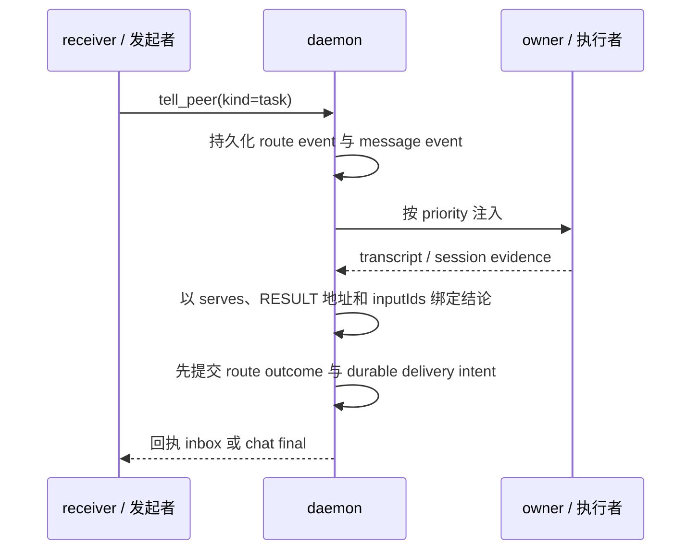

可靠性分成两层。message event 记录 `execution`（queued、dispatching、awaiting-result、complete、uncertain 等）与 `exposure`（none、possible、submitted、consumed）；final outbox 逐段记录发送状态。重启后 daemon 根据事件记录、transcript、当前 pane/session 归属和 transport ACK 恢复：能证明尚未暴露的输入可重试；已暴露但结果未知的输入保留为 uncertain，不在新 pane 上重复注入；明确拒收的发送可重试，ACK 不确定的发送不盲目重发，需继续观察或显式对账。回执以 `rcpt:<event>:<revision>` 去重，route outcome 先落账再交付。handoff 对被切断轮次有独立的持久标记和恢复路径。

旧工具名、旧地址参数、旧配置与定时格式的兼容入口已移除。route merge aliases、有限 `NO_DEADLINE`、可选 batch、当前合成结果指纹及身份懒初始化仍有当前写点，逐项依据见[版本兼容与当前语义边界](docs/evolve/receipt-router.md#版本兼容与当前语义边界)。

等待时间不会自动改变路由结局：当前实现没有按 deadline、pane 死亡或无结果次数合成 `timeout`、`silent`、`dead`。持久 deadline 用于 message event 的调度/有效性检查；route 的 `NO_DEADLINE` 表示不设自动失败期限。CLI 错误、NEED、取消和经证据确认的结果仍按各自语义处理。pane 消失或 ACK 不明确只会影响恢复判断，不等同于任务已经失败。

`shared/turn-state.ts` 从 route 行和 pane 探针派生 `working`、`blocked`、`needs-input`、`errored`、`deferred` 等展示状态；它不另存第二份任务状态。plan journal 记录 owner 显式维护的 DAG，route ledger 维护 receiver 欠账与结果交付；逐输入的 planId 仅用于提醒关联，不替代或推进任一方状态。

### 交接：换会话，不换身份

`handoff` 把工作压成一份简报，换一个全新会话接着干：**同一个 target、同一个名字，新的 sid、新的 pane**。不传 `name` = 交接自己（带 `brief`），传 `name` = 替那个 wizard 交接（`focus`）。

**交接不是压缩**：判断线是 `min(200k, 模型窗口的七成)`（`handoffAt`，`wizard_whoami` 的 `handoffSuggested`），而不是等快满——大 ctx 每一轮都在付钱，缓存一冷还要整段重写。越线后下一条注入捎一次提醒（每段会话一次），宪章要它在手上这摊告一段落、或往后的活不再依赖前面的材料时交接。窗口按它实际跑的模型查一张最小表（`[1m]` 与 Claude 5 家族 = 1M，haiku = 200k，认不出 = 200k）。简报贴回新会话成功后追加到 `~/.wezard/memory/episodes/<name>.jsonl`。身份、plans、日程、名册信箱都挂在 target / 名字上，换会话碰不到它们。会断的是那些隐含着「这个会话」的东西：

- **回执的答方**：欠着别人的那一句，答案要么已经在旧 transcript 里（换了会话 `replyFor` 就读不到了），要么还没答——义务得跟着简报转进新会话，而不是把简报那一轮的回复错当成回执；
- **回执的发方与一切注入**：重开的那几秒 pane 是死的，此刻投进来的话要么被当成「发话方已经不在」丢掉，要么 resume 回旧 sid，要么抢在简报前面成了新会话的开场白；
- **交接本身**：旧实现是一段纯内存的 async，reload 落在「杀了旧 pane、还没贴回简报」之间，新会话就空着醒来，简报没了。

所以 `handoff.ts` 做三件事：交接期间立一道闸、将被切断的终句与欠账落盘、在新会话恢复时对账（`~/.wezard/handoffs.json`）。闸是进程级单例——人话入口 `inbound` 在 mirror 块之前就装好了，拿不到实例；启动恢复时先建立交接闸，再恢复受影响的 message events，避免旧会话终句抢先外发。

图 12｜四个 stage，每一步先落盘再动手

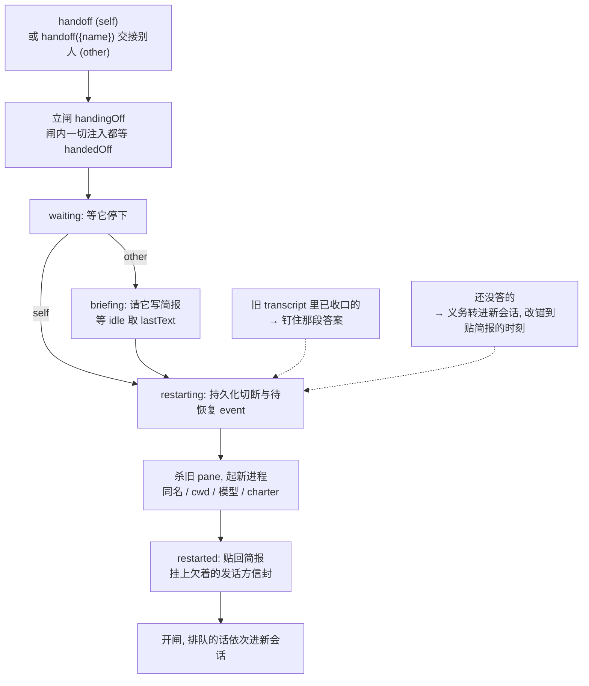

- **`stage` 落盘**，boot 时从断点接着做。reload 落在重开中途时靠 sid 分辨：`sid` 已经换了就是做完了，别再杀一次新会话。
- **清点的时机只有这一个**：一重开，旧 transcript 就再也读不到了。自我交接只认**调用之前**就收口的那些轮（调用这一轮的收尾话不是答案）；交接别人时，简报那一句已经把它之前的每一轮都关上了。
- **没等到 idle 就不能重开**——那会丢掉这次还在生成的简报。
- **交接恢复不靠旧 transcript watcher**：handoff 记录被切断的 event 与恢复状态；新会话逐项继续欠账，结果仍由 route `serves` 和当前 session/transcript evidence 归属。简报输入沿用交接时的频道。
- **失败只告诉它自己**：下一条进它会话的话尾巴上捎带一行，生命周期事件不进群。

### 频道：群是公开的，wizard 之间是私聊

名字全局可达以后，「这句话发到哪个群」不能再从 key 的 base 推出来了。于是每一轮 turn 记录一个 **channel**（`TurnDetailRecord.channel`）——这一轮的输入在哪儿说的、回复发到哪儿：

| channel | 含义 | 回复推到 |
| --- | --- | --- |
| `chat:…` / `user:…` | 公开频道：群，或与人的企业微信单聊 | 那个聊天 |
| `""` | wizard 之间的私聊 | **哪儿都不推**，只落 turn 记录（rolepage） |
| 缺省 | 老记录：按 `from` 推——peer 视为私聊，其余在 home | —— |

图 13｜同一次 tell_peer 的两种走向

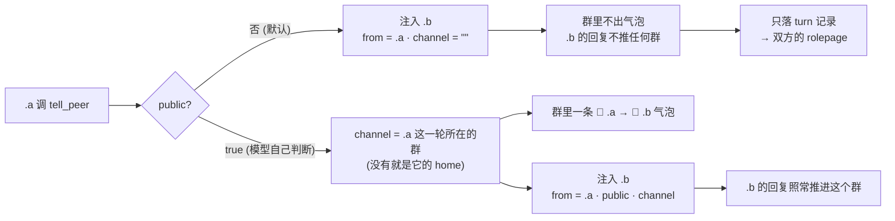

要不要公开由发话的 wizard 自己判断（`tell_peer` 的描述里写着：需要人知道、或本该当着人讨论的才 `public`；`delegate` 默认公开）。于是群里只剩人该看见的东西：**人发起的那一轮的回复**、`notify`、wizard 主动公开的讨论。分身出生、派活和计划更新不另发过程气泡；顶层模式下的协作往来一律私聊。

**一轮的终句去哪，由守护进程按「这一轮在为哪件 ask 服务」推定**，模型改不了：

- 人在群里说的、定时任务放的 → 那个群；
- 同伴私聊派来的活（包括 `clone_wizard({task})` 分身的第一轮，它的出处不带频道印章）→ `""`，结论作为回执回给它；
- 回执轮 → 按 route receiver 决定回到上游 wizard 或原始 chat；`serves`、显式结果地址与已消费输入证据决定归属，NEED / error 仍是中间态；
- CLI 把几句排队的话并成一行时，里面有私聊那句，整轮就按私聊——答复不跟着人的话进群。

计划提醒、交接里请它写简报的那一句、`.claude/**` 原生确认框代按失败后的告知，同样跟随发起它的那一轮的频道，没有一处注入是不带频道的。

注入的那一行会被 `recentInjects` 当成回显吞掉、走不到 tail 的 `user_text`，所以本轮的 `userQuery`（「谁对它说了什么」那一半）在注入的同时就盖进去；`channel` / `from` 同理，要早于 inject 落地——tail 是独立轮询的，可能在 inject 的 promise resolve 之前就开出 turn。

### 顶层模式：人只和顶层 wizard 说话

**默认就开**（`chatPolicy.<base principal>.topOnly` 不写 = 开，热生效；只有人显式写 `false` 的群才关）。它把这件事收紧成守护进程强制的规矩：

| | 关（显式 `topOnly:false`） | 开（默认） |
| --- | --- | --- |
| 人在群里面对谁 | 谁说话都可能进群 | 只有**顶层 wizard**：群管家，以及人 `.name` 点名的那个 |
| `tell_peer` / `delegate` 的 `public` | 照办 | 一律降为私聊（含 `re` 沿用的公开频道），回包带一句 `topOnly` |
| 为同伴干活的 wizard `notify` 进群 | 照办 | 409 退回（这一轮服务 wizard receiver task）；管家在自己的群豁免，人说的、定时任务等根轮不拦 |
| 宪章 | —— | 多一节「本群开着顶层模式」：顶层用自己的话讲结论、取舍和要人拍板的；子 wizard 以 `RESULT:` / `NEED:` 交回上游，由上游代为交代 |

配置键只认确定的聊天 id：`config_set` 写聊天名时换成它此刻指向的 principal 落盘，认不出的拒写。管家的宪章不论开没开都带一行「顶层模式」——开着时给关法，关着时讲它是什么、怎么开。

默认开之前，守护进程还兼职发现「该开而没开」的群（公开往来一多就往管家信箱挂一行提醒，`wrc.mirror.topOnlyNudge`）。默认开之后这个发现器没有对象了：只剩人**显式**关掉的群才可能公开往来，而那是人自己的决定，不该再被劝 —— 提醒机器 (`top-only-nudge.ts`) 与那组配置一并删掉。**开着顶层模式还连带一件事**：聊天的默认会话（管家）从此刻起真的按管家办事 —— 守护进程拦它改文件 / 开子代理，自己跑命令每轮限 `chatPolicy.<群>.stewardBudget` 次（读代码放行）。想某个群照旧自己动手，就把它显式关掉。

### rolepage：从 turn 记录折出一个 wizard 的 IM

chat 详情页过去折的是「一个聊天里有哪些会话」。名字全局唯一以后这个轴不对了：wizard 不属于某个聊天，它在好几个群里被人叫、跟好几个同伴私聊。rolepage（`shared/role-view.ts`，纯函数）换成**一个 role 的视角**重新折叠同一批 turn 记录：

图 14｜一轮 turn 拆成两条消息，按频道归进会话

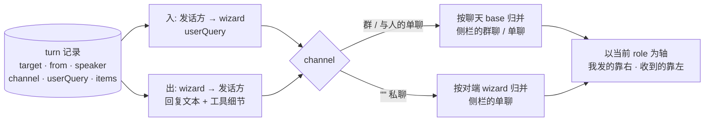

- **role**：wizard 就是它的 target key；人是 `human:<userid>`（不用 `user:<id>`——那正是「与这个人的单聊」里默认 wizard 的 target，字面相同会变成自己对自己说）；定时任务是 `task:<id>`，只发不收，不能切成视角。
- **发话方**：同伴（`from.kind=peer`）/ 定时任务（`task`）/ 人（`speaker`；老记录没有就记作「人」）。
- **侧栏**：群聊与单聊；群下展开成对子项（当前 role 与群里另一个 role 在这个群里的往来），「往来 / 全部」开关切到全部时再列出群里与它无往来的 role（淡色，点开是那个 role 在群里的全部记录）。侧栏可切成**关系图**：一棵树把家谱与对话画在一起，卡片就是会话项——排序、时刻、预览、未读、选中、忙闲共用同一份实现（`glanceOfTalk` / `convWindowOf` / `theirsOf`），改一边就是改两边。
- **两个独立视角**：**页面视角** `role`（名片、侧栏、标题、关系图中心）只由点头像、名字及其装饰切；**详情视角** `viewpoint`（URL 参数）只管详情区里谁靠右，由点卡片 / 会话项的其余地方、移交行、各种提示行以及气泡对面的空白设。详情区里的任何一行都不切页面视角——否则读着读着整页就换了主人。
- **未读**：会话项右边的红点只数**点开这一项看得到的**——服务端 `pendingOf` 按窗口、看的 role 与开口水位算出带消息 id 的可能未读，客户端减去已上屏的。名字旁的他人未读是**切到那个 role 之后它看得到的全部未读**（服务端 `unreadByRole` 按页面未读基线给每个 role 一份与侧栏同口径的账，随摘要下发 `peerUnread`）。已读全局只一份 `SEEN`（消息 id → 上屏时刻），片段在可见详情区上屏才记，与哪个视角、侧栏还是关系图无关，记下即两边重画。
- **计划视图**：通过「计划 / 日程」入口只读展示 `WorldFacts.plans` 中当前 owner 的计划，含状态、任务进度、依赖标题和暂停原因；有 plans 而无日程时入口也可见。世界刷新与摘要使用一致的计划事实，active/paused owner 的已登记身份及管理祖先不因近期消息裁剪而消失。sameBot 过滤计划 owner，公共投影不暴露内部 reminder 标记；编辑通过 owner 的 plan API 完成。
- **回执 chip**：回执那一轮的名字行展示状态并链接对应派活 event；`from` 的 event/status 来自 receiver 事实，不再展示工单成员 done/total。
- **忙闲**：空闲 / 执行中 / **等人点**（停在 daemon 发出的审批卡、提问卡上，紫色；取 daemon 的 pending，按审批认卡的同一口径归到 wizard）/ 已关闭。审批长轮询期间 pane 照样在转圈，不单列这一态就和真在干活分不出来。
- **用量条**：页脚两条（当前视角、窗口对端）——模型简名与 effort（取 transcript assistant 行上的 `effort`，没有才用绑定里的，都没有不显示）、估算费用（`shared/model-prices.ts` 是 LiteLLM 价格表的快照，认不出的模型不猜价、费用前加「≥」）、轮次、工具调用、API 请求、上下文（最近一轮主会话最后一次调用送入的 input + 缓存）、cache read / input / cache write / output 分布。
- **名片与日程**：身份、cwd、创建时间；同名下多个 session（`/clear`、`/new`、交接轮换）出切换器；「日程」列它名下（`owner`）的定时任务。
- **消息头**：多方会话（群、整个 chat）的名字行带这一轮的模型 / ctx / 耗时，两个 role 之间的对话只留时刻与耗时；同伴派来的那句带发话方发出它那一轮的账；进行中的一轮按开始时刻每秒走表。`<system-reminder>` 收成一个 `<reminder>` 标签，点开看原文。
- **路由**：`GET /role`、`/api/role`、`/api/msgs`（`?before=<msgid>` 按游标往前翻页）、`/api/role-events`（SSE）、`/api/world`（带 ETag，名册没变时轮询回 304）、`/api/glance`，daemon 与独立 svr 共用。`?id=` 是一条不可猜的记录 id，它就是凭据；页面的核心动作是顺着消息走到对端，而对端可能住在任何群，所以**任一有效票据可以看全部 role**（单用户部署下的取舍：名册本来就对每个 wizard 敞开）。要把正文严格关在一个群里的部署，不该对外暴露这些路由。链接里的 `role=` 用 target key 而不是名字，改名后旧链接照样能开。

---

## 配置：说人话改，放权要人点

wizard 读写配置只有两个工具，都由 `ConfigSchema`（zod）驱动，不维护第二份字段清单：

- **`config_get({path?})` 渐进披露**：不给 path 列各节一行说明；给了就列这一层子项的类型、当前值、默认值、说明，标出 ✋（改动要人确认）、↻（需 reload）、*（不同于默认）。说明取自字段的 `.describe()`，✋ / ↻ 由 `shared/config-meta.ts` 的 `knob` 标在 schema 上、沿树继承。`models` 下附各档模型的本周 / 今日用量；`chatPolicy.<聊天名>` 先换成它指向的 principal 再查。
- **`config_set({path, value, op: set|add|remove|unset, dryRun})`**：整份配置（叠上 secrets）过 zod 才写，经 `config-writer` 落盘保留注释；`dryRun` 回改前改后与 jsonc 行级 diff；热生效项写完即装进活的 cfg。

分级的界线是「放权」——谁能驱动本机、审批怎么判、跑哪个二进制带什么参数：

| 级别 | 路径 | 怎么改 |
| --- | --- | --- |
| 不可读写 | `bot.*`、认领口令、`secrets.json` 里出现的路径 | —— |
| 放权项 ✋ | `wrc.allowFrom`、`approval.*`、`claudeBin` / `cliBackends` / `extraArgs`、`sync`、监听与外送地址、`defaultChat` | 守护进程**自己**推确认卡，人点了才落盘——不经 hook，`danger.skipAll` 也压不过；卡在请求里等 4 分钟，之后回 pending，迟到的确认照常落盘并捎给调用方 |
| 其余 | 模型档位、`chatPolicy.*`、mirror 的各项开关… | 直接写 |

**改配置可能改宪章**：宪章是出生快照，改了配置活着的 wizard 看不到。`config_set` 落盘前后各渲染一遍有会话的 wizard 的宪章，按 `## ` 段比对——不靠字段清单，任何进宪章的配置都覆盖（自认是出生快照的档位行不比）。受影响的在回包里点名，调用方自己受影响就直说这一轮收尾后 `handoff`，其余各挂一条提醒随下一条消息到。人 `/name`、`name_chat`、自动补名这些聊天名写入点走同一个 `guardCharter`。

**写敏感状态的路由要口令**：`/config/set`、`/claim/start`、`/claim/reset`、`/tasks/schedule` 只认带 `x-wezard-token` 头、值等于 `~/.wezard/daemon-token`（0600，daemon 开机生成）的请求；wezard 自己的 MCP server 与 CLI 每次现读它，本机别的进程直接 curl 一律 403。PreToolUse hook 对 wezard CLI 的免审也只认整条命令就是一次只读子命令、不含 shell 元字符。

**默认摘掉的工具（`wrc.extraArgs`）**：wizard 首轮上下文里有一批它从不调用的工具，schema 每个会话白占、每次请求都要缓存读一遍。默认值用 `--disallowedTools` 把它们从工具定义里整个摘掉（不是只拒调用），交互式首轮实测 44 451 → 26 485 token：

| 摘掉的 | 省 | 近 400 个会话的调用 |
| --- | --- | --- |
| `Artifact` | 11.3k | 3 |
| `Workflow` / `SendFeedback` / `ScheduleWakeup` | 合计 5.6k | 0 |
| `mcp__claude_ai_Claude_Docs__*` / `mcp__claude_ai_Google_Drive__*` | 1.0k（deferred 名占位） | 0 |

- 不用 `--strict-mcp-config`：它连用户配的 MCP（lisct 等）一起丢掉，而 Chrome 的那段系统提示照旧在。Chrome 整套（`--no-chrome`，省 2.4k）没摘：weclaude 的 wizard 用它验 rolepage。`ListAgents` / `ReportFindings`（/code-review 用）、binote、wezard、lisct MCP 都在用，留着。
- 想恢复某个工具：显式写 `wrc.extraArgs` 会**整份覆盖**默认值、不合并——把默认那串抄过去、删掉那一项再 `config_set`（放权项，要人点卡）；写 `[]` 就全恢复。只对新起的 pane 生效，`--resume` 续上的会话可能沿用它录下的工具表。
- `extraArgs` 对所有 CLI 后端都追加：codebuddy / claude-internal 是否认 `--disallowedTools=` 这种写法**未验证**，用这两个后端的机器先试一个 pane。

---

## 缓存冷热判定（路由冷门控）

**冷热判定**（路由 `route_candidates` / `delegate` 与 `tell_peer` 冷门控，`route.wakeCostOf`）：TTL 由 `peers.cacheTtlSec` 读最近一次分档写入（`cache_creation.ephemeral_1h/5m` → 3600 / 300 秒，读不到按 300 秒兜底）；起点由 `peers.cacheTouchMs` 读最近一次已应答请求的**开始**时刻（它前面那行 user / tool_result），读不到才退回 mtime。mtime 是响应写完的时刻，实测比请求开始晚 p50 5 秒、p99 59 秒、最长 396 秒，还会被不碰缓存的元数据行推动；在 TTL 边界附近，用它会把已经冷了的判成热。

---

## 文档 MCP 如何桥接

`wezard` 把企业微信智能机器人的远端 MCP（doc / smartsheet / contact 等）桥接到本地 Agent，**不走 corp access_token**：daemon 直接复用 botId+secret 的 WS 长连，通过 `aibot_get_mcp_config` 命令拉到每个 category 的 Streamable HTTP MCP URL，再以 JSON-RPC 调 `tools/list` / `tools/call`，`x-openclaw-wecom-userid` header 透传文档归属人。

图 16｜一次文档写入穿过的四段链路

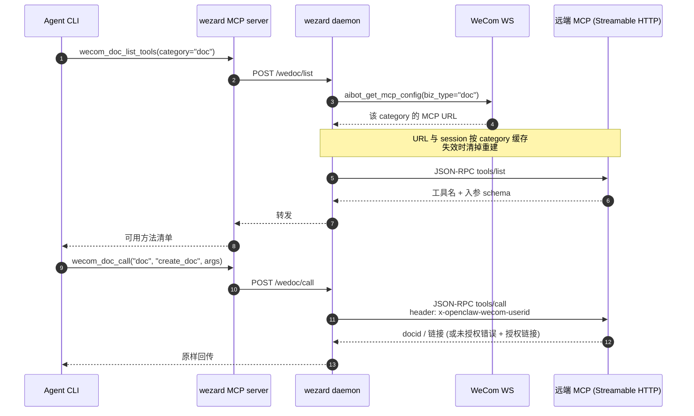

**前置一次性授权**：在企业微信「工作台 - 智能机器人 - 你的机器人 - 可使用权限」里勾选「文档」「智能表格」对应能力。第一次调用如果未授权，远端会返回结构化错误（errcode 851013）+ 授权链接，原样转给 Agent，照着点同意即可。

**Agent 侧自动发现**：模型先调一次 `wecom_doc_list_tools(category="doc")` 拿到工具列表（`create_doc` / `edit_doc_content` / `smartpage_create` / `upload_doc_image` ...）和入参 schema，再用 `wecom_doc_call(category, method, args)` 执行。category 当前可选：

| category | 能干嘛 |
| --- | --- |
| `doc` | 在线文档、智能文档、文档图片上传 |
| `smartsheet` | 智能表格的字段 / 记录读写 |
| `contact` | 通讯录查询（按需授权） |

**curl 验证**：

```bash
# 列 doc 类目下所有可用工具
curl -sS -X POST http://127.0.0.1:17890/wedoc/list \
  -H 'content-type: application/json' \
  -d '{"category":"doc"}'

# 创建一篇文档
curl -sS -X POST http://127.0.0.1:17890/wedoc/call \
  -H 'content-type: application/json' \
  -d '{"category":"doc","method":"create_doc","args":{"doc_type":3,"doc_name":"demo"}}'

# 写入 Markdown
curl -sS -X POST http://127.0.0.1:17890/wedoc/call \
  -H 'content-type: application/json' \
  -d '{"category":"doc","method":"edit_doc_content",
       "args":{"docid":"<返回的 docid>","content_type":1,"content":"# 标题\n正文"}}'

# 授权变更后清缓存
curl -sS -X POST http://127.0.0.1:17890/wedoc/invalidate -H 'content-type: application/json' -d '{}'
```

`requesterUserId` 解析顺序：调用方显式传入 → `defaultChat` 的 `user:<id>` 部分 → 不传（远端会拒，错误原样回到 Agent，比 daemon 提前判更透明）。
